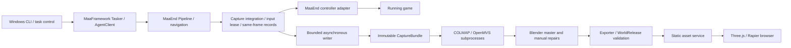
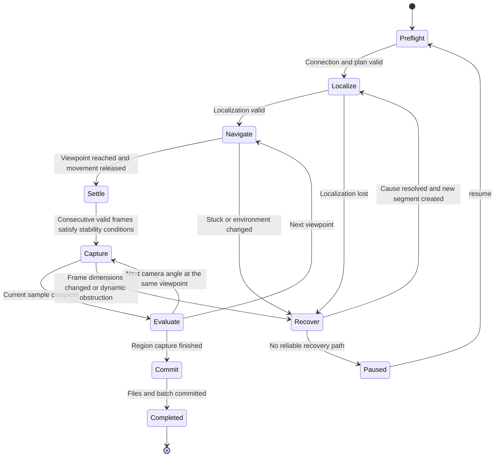

# Endfield Capture, Reconstruction, and Web Roaming — Detailed Architecture V1.0

Date 2026-11-09 (Asia/Shanghai). Inputs are the [requirements](requirements.md) and the user's confirmations in this session.

This document establishes the implementation baseline. Runtime acceptance is reported separately. **Confirmed** marks requirements fixed by the user, **Fact** marks source behavior checked in this session, **Design** marks decisions awaiting implementation, and **To verify** marks conclusions that require actual devices or samples. Formal schemas and validators are within this session's implementation scope. The capture runner, reconstruction executor, and web runtime are scheduled as subsequent tasks.

Implementation update, 2026-11-09: M0/C01 screenshot probing and the rendering core have started. New test code, synthetic examples, and game captures remain in workspace `local/` and are excluded from GitHub. Tests and examples added in the previous phase are removed from the current branch without rewriting history. Work pauses when Windows capture or manual mobile acceptance is needed; provide instructions and a result directory, then continue from the returned evidence.

## 1. Fixed Decisions and Delivery Boundaries

| Item | Decision | Status |
| --- | --- | --- |
| Capture platform | Windows, connecting to an already running instance of Arknights Endfield, with one-command startup through CLI + PowerShell / CMD | Confirmed |
| Task capabilities | Start, query status, pause, stop, resume, logs, and checkpoints, without a separate Windows GUI | Confirmed |
| Control boundary | Existing MaaFramework / MaaEnd controllers, with Windows handles confined to the adapter layer | Confirmed |
| Later platforms | Preserve architectural support for macOS, PlayCover, and ADB. Implementation and acceptance for the first version exclude these platforms | Confirmed |
| Production environment | COLMAP → OpenMVS → Blender as separate processes, either on the same machine or after transferring data to a Mac / Linux machine / workstation | Confirmed |
| Web boundary | The browser depends only on a static WorldRelease and runtime code, with no connection to the game or MaaEnd | Confirmed |
| First complete loop | Manually specify viewpoints in a small region, batch-process after capture, allow production repairs, and roam one chunk with the mobile profile | Design |
| Web stack | TypeScript + Vite + Three.js + Rapier, with React / R3F excluded from the first version | Design. A lightweight control interface needs no additional rendering lifecycle |
| Data organization | Two code repositories + a separate data directory inside the workspace, without a third contract repository, cloud queue, or application database | Design |
| Initial code | Formal data contracts, valid synthetic samples, validation CLI, and targeted tests | Delivered in this session |

Smooth operation and a higher-quality master remain goals. There are no constraints on cloud plans, edge nodes, or the final release package size. Synthetic samples cannot establish game-content results, actual frame rates, or reconstruction success rates.

## 2. Repositories, Processes, and Dependency Direction



Offline processes have neither permissions nor handles to control the game. Recapture can only return recommendations, which the capture coordinator checks before scheduling. The browser contains no MaaFramework SDK, capture-session paths, or code that connects to the game.

```text
用户工作区/
  docs/                              Reading entry point for this plan and detailed design
  enfield-capture-maaend/             MaaEnd fork retaining history and existing directories
    agent/cpp-algo/source/MapNavigator/  Existing localization, control, navigation, with minimal integration changes
    agent/cpp-algo/source/Capture/      Planned frame records, writing, and atomic photography actions
    assets/resource/pipeline/Capture/  Planned recognition-driven workflow
    tools/capture/                     Contract validation delivered, runner to be added later
    tools/reconstruction/              Planned offline task execution
    tools/blender/                     Planned import and export scripts
    tools/world-export/                Planned release packaging and pinned schema references
    contracts/capture/                 Authoritative CaptureBundle contracts
    docs/capture/                      Requirements, detailed design, implementation tasks
  endfield-world-web/                  Independent repository
    contracts/world/                   Authoritative WorldRelease contracts and synthetic samples
    tools/                             Release validation and targeted tests
    src/app/                           Planned entry point, loading status, and settings
    src/world/                         Planned release validation, asset and region lifecycles
    src/player/                        Planned input, character, and camera
    src/physics/                       Planned Rapier world and collision
    src/render/                        Planned render loop, quality, and resource disposal
  data/                               Raw images, batches, tasks, masters, release artifacts, excluded from Git
  local/                              Local qa, samples, validation, deliverables, excluded from Git
  .work/                              Session caches and validation temporary files, excluded from Git
  .venv/                              Isolated contract-validation environment for this session, excluded from Git
```

Every path written to disk, including logs, downloads, caches, and crash records, must remain inside this workspace. A future capture machine may use an equivalent workspace root of its own choosing. Portable contracts must exclude machine-specific absolute paths. The launcher must centrally configure MaaEnd's default build paths under that root and check resolved real paths before startup, beyond checking string prefixes.

The production toolchain follows upstream's own version requirements. Python contract validation runs independently in this session, which makes no claim that Python 3.9 can build all of MaaEnd.

## 3. MaaEnd Source Verification and Minimal Integration Design

The baseline is pinned to `MaaEnd/MaaEnd@8cccaaec8f59f4b4689b59db84a39d25066ff5ec`. The fork's `v2` retains upstream history. Feature development uses `feat/architecture-foundation`, which fast-forwards into the product `main` after review. Subsequent upstream merges must first pass integration regressions, without following a moving HEAD.

| Source location, relative to the capture repository | Facts verified in this session | Design and affected scope |
| --- | --- | --- |
| `assets/interface.json` | Win32-Front matches UnityWndClass / Endfield, captures with ScreenDC, and sends input with Seize. Other controllers include Adb, PlayCover, and MacOS | The CLI reuses configuration parsing and controller selection. Only Windows capture is enabled initially. Window names are baseline matching rules and cannot prove a successful connection |
| `tools/MapNavigator/` | Existing Python-side entry points support controller, resource, and Agent debugging | Reuse its initialization pattern. Check every caller before extracting genuinely shared initialization logic, without copying the entire tool backend |
| `MapNavigator/sensing/position_provider.cpp/.h` | After a screenshot, `captureWith` calls the observer before localization. `to_mat` depends on a local buffer, and failures have multiple early returns | Add a separate completion-record outlet covering every attempt, preserving the existing boolean result and semantics of `capture()` |
| `MapNavigator/state_machine/prompts.cpp` | `startScanners` installs a single observer, and `stopScanners` clears it | Preserve the existing observer behavior and add a capture-completion subscription slot with a lifecycle separate from the existing scan subscription |
| `MapNavigator/navi_controller.cpp` | `ActionWrapper` and `PositionProvider` are local objects within a navigation call. Stopping originates from `MaaTaskerStopping` | Keep local provider pointers out of global state. Use scoped subscription tokens, unregister subscriptions, and finish writing before exit |
| `MapNavigator/control/action_wrapper.*`, `Backend/backend.h` | Input dispatches through `IInputBackend` and `CreateInputBackend`, providing camera increments and movement control | Reuse the backend. Leases must constrain every input-producing path, including existing paths beyond the new photography actions |
| `MapNavigator/semantic/heading_turn.cpp` | Contains `pulseForwardSync(kPostHeadingForwardPulseMs)` | Photography must avoid HEADING. Use camera-only actions with movement inputs kept released |
| `MapNavigator/control/camera_pitch.cpp` | Empirical pitch mapping table | Use only as an initial input estimate and calibrate on site, without treating it as intrinsic or extrinsic ground truth |
| `agent/cpp-algo/source/main.cpp` | `MaaAgentServerRegisterCustomAction/Recognition` provides the registration entry points | New actions require synchronized registration, Custom Schema, Pipeline calls, and minimal tests |
| `agent/cpp-algo/source/CMakeLists.txt` | Recursively collects source files | New Capture sources can be discovered, but test sources must be explicitly excluded from production builds |

The complete integration change list covers the provider, navigation integration, and input backend above, new Capture atomic actions, registration in `main.cpp`, `tools/schema/custom.action.schema.json`, the Pipeline that actually calls the action, interface/task/all-language text changes only when exposing a task is required, and related C++ / Pipeline regressions and fixtures. This session adds only independent contract directories and validation tools, preserving these runtime paths.

Follow upstream's division in which the Pipeline manages flow and the algorithm layer handles difficult operations. Game UI recognition and state progression use the Pipeline. C++ handles same-frame data, resource lifecycles, atomic input operations, and lightweight gating. The Python CLI manages task lifecycles, batches, and offline production, without creating a second blind-keypress navigation runner. State recognition requires actual screenshots and ROIs before templates are created.

### 3.1 Same-Frame Record Order

1. Allocate `(session_id, clock_id, frame_id)` and record the screenshot request's monotonic time.
2. Capture through the existing MaaController and record the completion time when it finishes. Produce a failure record even when no image is obtained.
3. Continue providing the same image to navigation scanners in the existing order. Recognize the minimap to obtain this attempt's raw LocateResult, preserving separate states for planar position, character heading, and camera heading.
4. Complete the record consistently on every early-return path. A missing position must preserve a valid image, and a missing heading must preserve planar localization. Retain coordinates before and after normalization, together with the conversion ID.
5. Copy the image into a frame object that owns its memory only after obtaining writer-queue capacity. Borrowed `cv::Mat` data must never be saved asynchronously, and MaaContext or local controller handles must never be handed to threads outside the callback.
6. Publish an immutable `CaptureFrame` for asynchronous encoding and disk writes. If capacity is unavailable, record only a dropped-frame event, keeping the navigation thread unblocked.

The existing observer and the new completion subscription use distinct names and semantics so that existing scanners can retain their execution before localization. A single writer subscription is sufficient initially, without a general event-bus framework. Subscription callbacks must contain exceptions within the navigation loop boundary. Disk errors are reported to the coordinator and pause input.

The first version fixes each exported package to one session / clock lifecycle. In-process pause / resume preserves the clock. After a process restart, resume retains the logical task checkpoint but creates new session_id / clock_id / segment_id values, copies the plan with its session_id updated, and exports a separate package. Old sessions and batches remain unchanged. Subsequent reconstruction tasks explicitly reference multiple input packages, keeping them outside the current single-clock package. Frame IDs are never reused. Host request/completion times differ from game-render frame times. Unmeasurable native timestamps must be null. UTC anchors provide approximate ordering across clocks, while monotonic values from different clock_id values remain incomparable.

## 4. Windows CLI, State Machine, and Input Ownership

The following interfaces are planned for M1 and are unavailable in this session's implementation.

```text
capture doctor --workspace <root>
capture start --plan <plan.json> --workspace <root>
capture status --session <id>
capture pause --session <id>
capture stop --session <id>
capture resume --session <id>
capture logs --session <id> --follow
capture export --session <id> --batch <id>
scripts/start-capture.ps1 -Plan <plan.json> -Workspace <root>
scripts/start-capture.cmd <plan.json> <root>
```

The one-command scripts only check the environment and invoke the same CLI. They leave system execution policies unchanged and never log in, start the game, or install software implicitly. The task process reads control-command files atomically committed inside the workspace, while status commands read checkpoints. The first version needs no listening network port. Every command carries a command_id and session generation, with an ACK written after processing. Repeated commands are idempotent, and only the process holding the session's OS lock may send input.

Preflight checks Windows, the continued existence of the game window/process, controller connectivity, usable screenshots, resource and Agent versions, directory permissions and free space, and plan and map versions. The first frame must pass black-screen and size checks. Finding an HWND alone cannot establish capture readiness. An ambiguous selection or unstable state enters Paused with the reason logged, without choosing a random window.



Any active state can be interrupted by pause / stop. Implement a shared termination path that rejects new input → revokes the input lease → releases held keys/mouse buttons/touches → waits a bounded time for actions to exit → commits persisted frames and a checkpoint. Exceeding the deadline records failed, and frames still unwritten cannot count as completed.

| Lifecycle event | Persisted state | Resume behavior |
| --- | --- | --- |
| pause / window loses focus / write backlog | paused, retaining the next unfinished viewpoint | resume repeats preflight and localization, without continuing a partially completed mouse action |
| stop / Ctrl+C | stopped, closing the current batch and retaining confirmed data | Explicit resume may continue the logical plan. After a process restart, use a new session/segment/clock and export a separate package |
| Disk full / Agent disconnected | failed, recording the error code and last complete checkpoint | After repair, resume rechecks hashes and preserves corrupt files without overwriting them |
| Game area transition / teleport / camera-mode change | paused or recovering, with a new trajectory segment/calibration group | No interpolation across the discontinuity or continuation from the old navigation position |
| Task complete | completed | No automatic rerun. A new task gets a new session |

InputArbiter belongs to each controller session, beyond individual camera actions. The owner is restricted to `navigation / capture / recovery / none`. Switching increments the lease generation, and queued actions from an old generation remain prohibited even if they wake up. Priority is stop/focus loss > recovery > capture > navigation. A switch must wait for the previous owner to release control. Other MaaEnd routine tasks cannot run concurrently with capture on the same controller. Coverage includes scanner-triggered interactions, recovery from being stuck, camera actions, and movement, beyond Capture calls alone.

The control-plane polling design target is 100 ms, and the input-release target is 500 ms. Both require actual-machine verification and depend on blocking backend calls. Normal stopping must be tested. User-space cleanup cannot be guaranteed after a forced process kill, a stalled driver, or power loss. Launcher recovery first sends release operations and requires preflight to run again.

Settling is determined from image differences and an observation-stability window, with thresholds stored in calibration configuration. A timeout returns recover. A fixed sleep alone cannot establish stability. After a camera increment completes, confirm with a new frame and preserve the differences between photography inputs and observations.

## 5. Bounded Writing, Immutable Batches, and Transfer

The default is one writer with a bounded queue, initially limited to both 8 frames and 256 MiB, whichever is reached first, measured using actual uncompressed bytes. Pause new photography samples at the high-water mark and continue below the low-water mark. These limits are starting points for measurement and carry no performance guarantee. Reject an individual frame that exceeds the budget and record the reason explicitly. Encoding and disk waits must leave screenshot/navigation responses unblocked.

For each frame, write a temporary image → flush / fsync → rename within the same directory → write the frame record → flush. Active JSONL files may be appended to. The delivered frames.jsonl is a frozen batch snapshot, and a growing file must never enter a committed hash index. Write the batch directory as `.partial` first and atomically rename it on the same volume after successful validation. Write bundle.json last. If external storage lacks equivalent atomicity, the receiver first copies into local staging, validates every entry, and only then marks the batch committed.

An image successfully written without its record becomes an orphan file and is quarantined during recovery. Its filename cannot justify inventing a success record. An incomplete final JSONL line fails validation of that snapshot. The writer explicitly recovers an active log tail by truncating to the last confirmed offset and saving the damaged tail as a diagnostic copy. Disk-full conditions prohibit batch commits. Multiple batches may reference the same frame_id, with deduplication by hash while preserving original image filenames.

Cross-machine handoff transfers only frozen CaptureBundles. Offline tasks start only after all files are present, paths are relative, and hashes pass validation. Masters and reconstruction outputs also include traceable manifests. Absolute tool-installation paths remain in workstation configuration and stay outside portable packages.

## 6. Contract Ownership, Compatibility, and Coordinates

| Contract | Authoritative repository | Scope in this session |
| --- | --- | --- |
| CaptureBundle / Session / Plan / Frame / Batch | `enfield-capture-maaend/contracts/capture/` | Formal draft 2020-12 schemas, synthetic bundle, read-only validation |
| WorldRelease / AssetIndex / Collision | `endfield-world-web/contracts/world/` | Formal schemas, tiny self-authored assets, read-only validation |
| ReconstructionBundle / PreviewSnapshot / RescanRequest / MasterAssetSet | Future `contracts/reconstruction/` in the capture repository | This document defines fields and constraints. Schemas are implemented in their respective tasks and remain future work |

Every schema category is versioned. Initial readers declare support only for `*/1.0`, reject unknown major versions, and request a reader upgrade for unknown minor versions. Noncritical additional fields within the same version may be ignored. Changing axes, units, field meanings, or removing required fields requires a major-version increase. New required capabilities need explicit capability gating and must remain outside ignorable fields.

The web repository exclusively maintains the World schemas. The exporter uses a local copy or artifact package pinned by Git commit + file SHA-256 and records it in `contracts.lock`, without downloading latest at startup. Consumers must preserve vendor copies unchanged. Contract changes first update the authoritative schema, samples, and negative cases, then update producers. No third repository or npm publication is needed.

Structural and semantic validation are separate. JSON Schema checks types and required fields, while tools check unique IDs, reference closure, time ordering, LOD, transforms, file existence, hashes, and paths. Every path is relative to the package root. Absolute paths, protocols, parent traversal, encoded escapes, and symlinks crossing the root are rejected. JSON prohibits NaN/Infinity and duplicate keys. Contract versions cannot substitute for file integrity.

### 6.1 Required Semantics

CaptureBundle includes a complete file index that excludes itself to prevent circular hashing, snapshots of session / plan / frames, and committed batches. Each batch's `frames_uri` points to a separate `records/<batch>.frames.jsonl` shard. Batch file hashes bind the plan, shard, and raw images, excluding the continuously growing aggregate index. `session_identity` fixes the session, clock, source, and controller, with calibration snapshots saved alongside each batch. Root `frames.jsonl` is the frozen exported package's aggregate index and must agree with every shard record. The first version fixes one plan revision per package, exporting separate packages across plan revisions.

Rejected images and screenshot failures are distinct states. A successful screenshot may lack navigation results. Times are decimal nanosecond strings. Within the same clock_id, request ≤ complete ≤ locate_complete, with unexecuted stages set to null. Camera-solver results are separate revisions linked through frame_id and never backfilled as original ground truth.

A minimal WorldRelease contains scene/release/world_frame, scale provenance, a feet-origin spawn, character asset, camera, profiles, chunks, asset index, and build provenance. `mobile` is required, and other profiles are optional. Each chunk's bounds_world is already in world coordinates. Its transform applies to local geometry once, with a uniform positive scalar scale. LOD arrays run near to far, start with min_distance_m=0, and have strictly increasing later thresholds based on the camera's distance to the world bounding box. The runtime uses hysteresis. Collision is independent and stays unchanged across LOD switches.

The minimal collision contract in this session uses boxes. Static triangle meshes required by actual terrain will receive explicit types and validation during the asset stage. A boxes sample cannot establish slope coverage. WorldRelease's asset_index_sha256 binds the asset index, which in turn binds each asset's byte length and SHA-256. world.json remains the outer distribution trust root, and hashes provide no publisher authentication. Assets declare dependencies, type, and required_extensions. The runtime loader enables only decoders permitted at build time and never executes arbitrary code named by a manifest.

### 6.2 Fields for Subsequent Intermediate Artifacts

| Artifact | Minimum fields and state rules |
| --- | --- |
| ReconstructionBundle | revision, parent_revision, region_id, input_batch_ids / hashes, toolchain/config hash, world_frame_id, scale_status, camera_file, mesh/texture refs, quality_report. Release pointers reference only accepted revisions |
| PreviewSnapshot | preview_revision, source reconstruction revision and batches, world_frame_id, camera/sparse geometry refs, diagnostics. It cannot serve as a WorldRelease |
| RescanRequest | request_id, source_revision, region, reference_frame_ids, issue extent, recommended viewpoints, mapping_revision, status. Convert to a plan only when executable and the current mapping remains valid |
| MasterAssetSet | master_revision, source reconstruction, coordinate revision, Blender version, collections, manual_patch revisions, export config. Reconstruction must preserve manual repairs |

### 6.3 Coordinate and Image Conventions

Computations use column vectors and `T_target_from_source`, with matrices serialized row by row in JSON. All quaternions use XYZW and unit length. COLMAP's original WXYZ format is converted at the import boundary. Angle-field suffixes specify deg/rad. Native navigation angles retain their original conventions and cannot fill a full camera pose.

COLMAP uses `x_cv = R X + t`, with camera center `C = -Rᵀt`. Reconstruction coordinates map to the canonical world through `Xw = s Ra X + ta`. Browser cameras look along local -Z, with basis `D = diag(1,-1,-1)`, giving `Cw = s Ra C + ta` and `R_world_from_web_camera = Ra Rᵀ D`. Scale affects positions/geometry only and stays out of rotation quaternions. [COLMAP official format](https://colmap.github.io/format.html)

The canonical world is right-handed, +Y-up, and measured in meters. Blender production uses `(x_b,y_b,z_b)=(x_w,-z_w,y_w)`. During glTF export, the exporter converts back to Y-up exactly once. Every world-coordinate revision invalidates collision, spawn points, anchors, and exported assets together. Moving visible meshes alone is prohibited.

scale_status=`arbitrary / estimated / verified`. Reconstruction may remain arbitrary. A roamable release requires estimated or verified scale with its basis explained. Estimated scale supports a usable control experience without claiming recovery of the game's physical scale.

Image origin is top-left, with the continuous pixel-center convention `(0.5,0.5)`. Store original dimensions and the valid image region. Cropping and scaling record `A_processed_from_raw` and update `K'=AK`. If a processing library uses integer pixel centers, its adapter records the half-pixel offset. Undistortion separately records the model, original intrinsics, new intrinsics, and mapping, beyond what a single linear A can represent.

## 7. Offline Reconstruction, Quality, and Recapture

The preferred task DAG is verify → preprocess → feature/match → COLMAP mapping → undistort → OpenMVS import → densify → mesh → refine → texture → quality → Blender. Explicitly list every stage's inputs and outputs. A failed stage blocks progression. Beyond process exit=0, verify that artifacts exist, can be parsed, and have consistent references.

| Stage | Invocation design | Main checks |
| --- | --- | --- |
| Preprocessing | Preserve raw images and generate images and valid regions by calibration group. Static HUD and character masks may be prepared manually | Dimensions, intrinsic mapping, mask orientation and coverage |
| COLMAP | `feature_extractor`, `exhaustive_matcher` for small regions, `mapper`, `image_undistorter` | Camera groups, registration rate, connected components, trajectories, reprojection, and held-out inspection views |
| OpenMVS | `InterfaceCOLMAP` → `DensifyPointCloud` → `ReconstructMesh` → `RefineMesh` → `TextureMesh` | Undistorted camera/image mapping, nonempty outputs, dynamic-content leakage, holes |
| Blender | Batch processing in a separate subprocess and manual production | Units, axes, repair provenance, render/collision consistency |
| Release | Export to staging → schema/semantic/hash validation → atomic commit of the release directory | Reference closure, standable spawn, accepted provenance |

Command names specify workflow choices. In M0, run `--help` on each installed binary version and pin its actual arguments. Architecture design must avoid inventing a universal command for every version. Configure OpenMVS import and dense stages according to the selected version's official instructions. [OpenMVS official workflow](https://github.com/cdcseacave/openMVS/blob/develop/docs/wiki/Usage.md)

Whether MVS / texturing actually consumes masks must be verified with black-and-white test masks. COLMAP feature masks cannot be assumed to propagate automatically. If the selected version lacks the required mask propagation, suspend acceptance of affected assets and choose static viewpoints, remove contaminated frames, or explicitly perform manual cleanup. Black fill cannot establish correct masking. Apple GPUs provide no CUDA capability. Mac/Linux may run applicable tool stages, but CPU execution or another workstation must be selected according to actual build options, without cross-platform performance promises.

Each task's build key hashes a canonical serialization of input-file hashes, schemas, coordinate/calibration revisions, tool versions, parameters, and random seeds. States are `queued/running/succeeded/failed/cancelled/needs_review`. JSON checkpoints are sufficient, and an exclusive task lock prevents two processes from writing the same output. Reuse completed stages only when the key matches and hashes pass. Changes to input images, masks, camera groups, or tool versions invalidate the affected downstream stages.

The initial version processes one region serially. M4 adds background sparse previews that read committed batches and coalesce pending previews for the same region. Commit only one revision per region at a time. Reusing an incremental database requires compatible versions and camera models, immutable source frames, and other prerequisites. Otherwise rerun the region. Stale jobs retain historical outputs without updating the current pointer. The acceptance workflow updates the formal release pointer independently of preview.

Recapture checks proceed in order from a still-valid source revision → correct mapping of the issue to a region/floor → acceptable mapping error → reachable viewpoint → no conflict with the current plan. Otherwise use status=`needs_mapping` or `manual_review` and deliver reference images and region hints without generating a blind route. The first version allows a person to rerecord the plan from these suggestions.

Quality acceptance combines camera registration/connectivity, trajectory plausibility, geometry holes, held-out views, and actual walkable surfaces. Populate thresholds in runtime configuration after M0 experiments. Completing navigation, obtaining valid images, and passing reconstruction quality are three independent metrics.

## 8. Blender Masters and Reproducible Export

Organize each region's master into Collections named `Source_<revision>`, `Working`, `ManualPatches`, `Collision`, `Anchors`, and `Export_mobile`. Source is read-only, and each new reconstruction imports as a separate revision. Manual repairs remain independent and record their source and applicable coordinate version. Incompatible transforms require manual migration. Nearest-point matching must never automatically attach old repairs.

The primary rendering approach uses screenshot-baked appearance, initially with weak lighting or unlit materials to avoid adding shadows over those already captured. Align texture color spaces, exposure, and tone mapping between production and the web, checking against reference views. Screenshots do not automatically supply true roughness or metallicity.

Create collision proxies separately and inspect ground continuity, doorways, wall thickness, slopes, steps, and boundaries. Derive every quality profile directly from the master, preserving a separate source for high quality instead of generating it from compressed mobile assets. Choose one geometry-compression path, Meshopt or Draco, and configure KTX2 according to device capabilities. The first self-authored sample may require no decoder extensions.

Before export, freeze local transforms into the single declared hierarchy level. Rendering and collision use the same world_frame_id. Hash every file and record source batches, reconstruction revision, master revision, and exporter/config. Keep generated and hand-edited areas separate. Repeated exports replace only the generated area, and a failed release preserves the previous release.

## 9. Web Runtime

| Module | Input → output / lifecycle |
| --- | --- |
| App | Entering the world, loading errors, pause, and quality settings. Ordinary UI omits production-tool internal terminology |
| WorldLoader | Schema-version/capability/URL-root validation → manifest + asset dependency graph. A failed validation prevents scene mounting |
| AssetRegistry | Content-hash deduplication, reference counting, AbortController, decoding → Three.js resources. Release geometry/material/texture and ImageBitmap |
| PhysicsWorld | Static collision + capsule kinematic body in consistent world coordinates. Fixed 1/60-second step, at most 5 catch-up steps, with backlog discarded after long pauses |
| PlayerController | Movement intent in the camera's horizontal reference → acceleration/deceleration, gravity, KCC-corrected displacement, grounding, safe points |
| CameraRig | Orbit angles/follow distance → capsule/sphere shape casts for obstruction avoidance. Free camera has independent state |
| InputRouter | Keyboard/mouse/multitouch → per-frame intent. Clear on blur, pointercancel, visibilitychange, and mode changes |
| QualityManager | Sustained frame times → resolution/shadow/quality adjustments. Manual selection takes priority |
| WorldStreamer (M5) | Current chunk, adjacency, movement direction → bounded concurrent requests, collision readiness first, eviction of departed chunks |

Loading order is manifest → core-capability validation → asset index → minimum rendering and collision for the spawn chunk → verify the spawn support surface → character → enable input. Gravity stays disabled while waiting. Loading failure preserves the previous valid scene or displays a retryable error, keeping the character from falling.

Rapier KCC computes acceptable displacement, while the application manages gravity and grounding. After moving the body, synchronize the visual capsule/placeholder character. spawn represents the feet, so the capsule center adds half-height and radius. Initial character animations are in-place without root motion. [Rapier controller](https://rapier.rs/docs/user_guides/javascript/character_controller/)

Third-person is the default. Mouse/right touch region rotates, and the left touch region moves. Pointer Lock is enabled only with a user gesture and browser support. Provide unlock and pause buttons with keyboard accessibility and readable names. Free camera defaults to bypassing character collision, with the mode clearly shown. Returning to character mode restores the last safe feet position, without forcing the capsule to the flying-camera position.

Chunk states are unloaded → queued → fetching → decoding → ready → active → retiring → unloaded. Every scene switch increments generation. Results from older asynchronous work are destroyed on completion instead of mounted again. Collision for the current chunk and the next chunk being entered has residency protection. Restrict boundary crossing until readiness, and prevent visual LOD from triggering collision unloading. Dispose shared resources only after their last reference is released. Context loss pauses input and physics. On recovery, rebuild GPU resources or return to an explicit retry entry point.

## 10. Mobile Performance and Expansion Order

The first mobile profile defaults to a DPR cap of 1.5, with real-time shadows and heavy post-processing disabled. These are experimental starting points that may change after measurement. The performance goal is sustained roaming near 30 FPS on representative iOS Safari and Android browsers, aiming for 60 FPS on stronger devices. A UA string cannot establish acceptance.

Sampling uses actual frame times and long frames from a visible page. For example, exceeding budget for 5 consecutive seconds first lowers render resolution, followed by a 10-second cooldown after each adjustment. Upgrading again requires a longer stable window. Inspect both the mean and p95, recording loading peaks separately. If the lowest quality still fails, explicitly mark the device below target and keep the metrics visible. CSS viewport screenshots cannot replace acceptance on actual mobile devices.

M3 records frame times, draw calls, triangles, loading peaks, background recovery, and observed heating during 10 minutes of walking. When the browser cannot provide exact VRAM usage, record the estimation method. Optimize visible extent, materials, and resolution before adding LOD and streaming. In M5, cross region boundaries at least 10 times and check that residency and memory do not grow continuously and that characters remain supported at boundaries.

## 11. Responsibilities, Implementation Tasks, and Completion Criteria

Astra (gpt-6-Astra-xhigh) owns architecture, complex tradeoffs, integration acceptance, and task decomposition. Coding, reviews, and unit tests use gpt-6.1-sol-xhigh, with at most three subagents active simultaneously. Nested spawning must stay within that limit. Assign nonconflicting directories, and let Astra finalize cross-repository contract alignment. Astra decides how to resolve issues without requesting permission midway.

| ID / stage | Repository and owner | Dependencies / inputs | Outputs | Completion criteria |
| --- | --- | --- | --- | --- |
| A01 / Architecture | Astra / both repositories | Original plan, source baseline, user additions | Detailed design, task list, platform boundaries | No blockers awaiting user decisions. Facts and design remain separate |
| C00 / Contracts | Sol / capture | A01 | Schemas, synthetic bundle, validator, tests | Positive cases pass. Invalid hash/path/reference/time/uncommitted cases fail |
| W00 / Contracts | Sol / web | A01 | Release/index/collision schemas, self-authored sample, validator | Invalid reference, LOD, transform, hash, and path cases fail |
| R00 / M0 | Sol / capture | C00, actual small-region samples | Pinned tool versions, reconstruction experiment records | Held-out views allow geometry-quality assessment. Failure causes can be located |
| W01 / M0 | Sol / web | W00, self-authored untextured model | Single-chunk Vite/Three/Rapier prototype | Desktop and touch movement, collision, camera, pause, and actual-mobile records |
| C01 / M1 | Sol / capture | C00, Windows game and SDK | doctor/start/status, startup scripts, controller connection | Reject when the game is absent. Connect and capture correctly without a separate GUI dependency |
| C02 / M1 | Sol / capture | C01, provider source | Same-frame completion records, bounded writer | Record failures too, avoid previous-frame associations, ensure asynchronous memory safety, preserve existing scanners |
| C03 / M1 | Sol / capture | C02, actual recognition templates | Pipeline capture states, photography actions, input leases | Capture after settling. Prohibit implicit HEADING forward movement. Every input path obeys its lease |
| C04 / M1 | Sol / capture | C03 | pause/stop/resume, command ACKs, checkpoints, logs | Cancellation tests in every active state, safe stop on disk full/disconnection, transferable complete batches |
| R01 / M2 | Sol / capture | R00, C04 | Offline CLI, task DAG, recovery and quality reports | Validate and process a Windows bundle on another workstation. After interruption, rerun only invalidated stages |
| B01 / M2 | Sol / capture | R01 | Blender master/repair protection/collision/export | Coordinate-anchor round trips, preserved old repairs, rendering and collision from the same source |
| E01 / M2 | Sol / capture + web | B01, W00 | Pinned schema dependency, formal WorldRelease | Exported package passes both repositories' consumer validation and provenance tracing. Static deployment is independent of the game |
| W02 / M3 | Sol / web | W01, E01 | Actual-scene loading, input, camera, disposal | Walk through doorways, slopes, steps, and boundaries. Dispose on reload. Meet the 10-minute mobile experience target |
| C05 / M4 | Sol / capture | R01, quality feedback | Preview revisions and RescanRequest schema/scheduling | Avoid partial bundles, preserve newer revisions, prohibit automatic navigation without mapping |
| X01 / M5 | Sol / both repositories | M3, M4 | Multi-region registration/multi-profile LOD/streaming | Consistent coordinates/seams, reclaimable resources after repeated crossings, queued fallback under low resources |

C00/W00 provide the executable foundation in this session. M0–M5 describe subsequent product implementation. C++ unit tests for C02 must link independently, preventing recursive source collection from adding a test main to cpp-algo. Schedule corresponding node tests when C03 modifies the Pipeline. Passing schema tests cannot replace acceptance on an actual Windows machine.

## 12. Git, Traceability, and Initial Risks

The account is fixed as RabbitStudioChino. The capture fork retains a public upstream relationship, and the independent web repository starts private. Push only product code, design, formal schemas, and dependency locks. Exclude new test code, all examples, game frames, model masters, and log data. Preserve existing upstream history and tests without destructive cleanup. Retain upstream AGPL and copyright notices. The web license will be decided from the actual code sources.

Chinese commit messages consistently follow `类型(范围): 摘要`, for example `docs(架构): 明确双仓职责与平台边界`, `feat(采集协议): 校验不可变批次与帧关联`, and `feat(世界协议): 校验发布资产与碰撞引用`. Commit and push each complete feature separately, excluding failed intermediate artifacts. Commit identity uses RabbitStudioChino's GitHub noreply address configured locally for each repository, preserving other projects' account settings.

Upstream synchronization retains the upstream remote and records the baseline and pinned submodule SHAs. Fork a submodule separately only when it needs modification, without automatically updating submodules to their latest branches. Architecture files are tracked in capture `docs/capture/`, with identical reading copies in workspace `docs/`. Changes follow the repository version and synchronize the copies, maintaining a single authority.

| Initial risk | Required experiment | Decision rule |
| --- | --- | --- |
| Actual RGB cannot reconstruct reliably | Multiple views and held-out views in a small region, measuring registration/geometry and occlusion | Keep full-map automation blocked until this passes. Change capture angles/masks or explicitly perform manual repairs |
| Scaling affects ScreenDC frames and raw resolution | Compare window and screenshot sizes, minimized/unfocused/HDR states | Record actual dimensions/color. The 720p navigation-template size cannot stand in for raw capture resolution |
| Input stopping misses old asynchronous actions | Test pause/stop/focus loss in each state and align controller action logs | Prevent old-generation execution. Resume only after keyboard and mouse release |
| Same-frame association and memory-lifecycle errors | Numbered synthetic frames, injected recognition failures, slow writer | Image/localization share an ID, the queue is bounded, scanner regressions pass |
| Tool capabilities differ by platform | Probe target binaries and run the actual small-sample workflow | If a GPU backend is absent, use another workstation or an available CPU path, without fabricating success |
| Master revisions break repairs and collision | Import old/new reconstructions and round-trip anchors | Preserve repairs, invalidate the entire coordinate-dependent chain on coordinate changes, switch releases as a whole |
| Sustained mobile performance falls below target | Ten-minute roaming on representative devices and repeated cross-region loading | Lower quality/chunk according to bottlenecks. Record devices below target without universal guarantees |

Still unverified are connection to and capture from a running Windows game, actual reconstruction quality, real Blender export, web roaming, and mobile performance. Architecture conclusions, contract validation, and repository establishment are separate deliveries, with first-version product completion reserved for its own acceptance.
