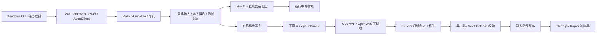
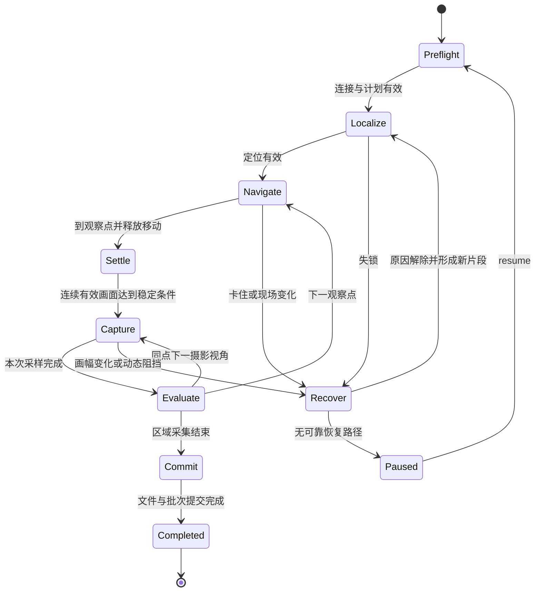

# 终末地采集、重建与网页漫游：详细架构 V1.0

日期：2026-11-09（Asia/Shanghai）。输入：[需求方案](requirements.md) 与本次用户确认。

本文是实施基线，不是运行验收报告。标记含义：**确认**为用户固定要求，**事实**为本轮核对源码，**设计**为待实现决策，**待验**为需要真实设备或样本的结论。正式 schema 和校验器是本轮实现范围；采集运行器、重建执行器与网页运行时均列入后续任务。

2026-11-09 实施补充：已开始 M0/C01 截图探针与渲染核心。新增测试代码、合成样例、游戏采样全部保存在工作区 `local/`，不进入 GitHub；上一轮新增的测试和样例从当前分支移除，已有历史不改写。需要 Windows 实机采集或手机人工验收时暂停推进，提供步骤和结果接收目录，再根据返回证据继续。

## 1. 固定决策与交付边界

| 项目 | 决策 | 状态 |
| --- | --- | --- |
| 采集平台 | Windows，连接已运行的《明日方舟：终末地》，CLI + PowerShell / CMD 一键启动 | 确认 |
| 任务能力 | 开始、状态查询、暂停、停止、恢复、日志、检查点；无需独立 Windows GUI | 确认 |
| 控制边界 | MaaFramework / MaaEnd 原控制器；Windows 句柄只存在于适配层 | 确认 |
| 后续平台 | macOS、PlayCover、ADB 保留架构，首版不实现、不列验收项 | 确认 |
| 制作环境 | COLMAP → OpenMVS → Blender，独立进程；同机或搬运数据到 Mac / Linux / 工作站 | 确认 |
| 网页边界 | 浏览器只依赖静态 WorldRelease 和运行时代码；不连接游戏或 MaaEnd | 确认 |
| 首个闭环 | 人工指定小区域观察点，采完后批处理、允许制作修补、手机档单块漫游 | 设计 |
| 网页技术 | TypeScript + Vite + Three.js + Rapier；首版不加入 React / R3F | 设计：轻量控制界面无需额外渲染生命周期 |
| 数据组织 | 两个代码仓库 + 工作区内独立数据目录；不建第三个协议仓库、云队列或业务数据库 | 设计 |
| 首轮代码 | 正式数据契约、合成有效样例、校验 CLI、针对性测试 | 本轮交付 |

运行流畅与较高质量母版仍是目标；不设置云套餐、边缘节点或最终发行包大小约束。游戏内容、真实帧率、重建成功率不得由合成样例推断。

## 2. 仓库、进程与依赖方向



离线进程没有控制游戏的权限或句柄；补采只能返回建议，由采集协调器核对后排程。浏览器中不存在 MaaFramework SDK、采集会话路径或连接游戏的代码。

```text
用户工作区/
  docs/                              本次方案和详细设计的阅读入口
  enfield-capture-maaend/             MaaEnd Fork，保留历史与既有目录
    agent/cpp-algo/source/MapNavigator/  既有定位、控制、导航；最小接入改动
    agent/cpp-algo/source/Capture/      拟新增帧记录、写入与摄影原子动作
    assets/resource/pipeline/Capture/  拟新增识别驱动流程
    tools/capture/                     协议校验已交付；运行器后续新增
    tools/reconstruction/              拟新增离线任务执行
    tools/blender/                     拟新增导入与导出脚本
    tools/world-export/                拟新增发布打包及固定 schema 引用
    contracts/capture/                 CaptureBundle 协议权威
    docs/capture/                      需求、详细设计、实施任务
  endfield-world-web/                  独立仓库
    contracts/world/                   WorldRelease 协议权威与合成样例
    tools/                             发布校验与针对性测试
    src/app/                           拟新增入口、加载状态和设置
    src/world/                         拟新增发布校验、资产与区域生命周期
    src/player/                        拟新增输入、角色、镜头
    src/physics/                       拟新增 Rapier 世界与碰撞
    src/render/                        拟新增渲染循环、画质和资源释放
  data/                               原图、批次、任务、母版、发布制品，不进 Git
  local/                              本地 qa、samples、validation、deliverables，不进 Git
  .work/                              本次缓存、校验临时文件，不进 Git
  .venv/                              本次独立契约校验环境，不进 Git
```

所有落盘路径（含日志、下载、缓存、崩溃记录）必须位于本工作区。未来采集机可使用等价的自选工作区根，不能把本机绝对路径写进可搬运契约。MaaEnd 构建默认路径需由启动器集中配置到该根；启动前检查解析后的真实路径，不仅检查字符串前缀。

生产工具链遵循上游自身版本要求；本轮 Python 契约校验独立运行，不代表 Python 3.9 能构建整个 MaaEnd。

## 3. MaaEnd 源码核验与最小接入设计

基线固定 `MaaEnd/MaaEnd@8cccaaec8f59f4b4689b59db84a39d25066ff5ec`。Fork 的 `v2` 保留上游历史，功能开发使用 `feat/architecture-foundation`，审查后快进到产品 `main`。后续合并上游先跑接入回归，不跟随浮动 HEAD。

| 源码位置（均相对采集仓库） | 本轮核实事实 | 设计及影响范围 |
| --- | --- | --- |
| `assets/interface.json` | Win32-Front 使用 UnityWndClass / Endfield 匹配，ScreenDC 截图、Seize 输入；另有 Adb、PlayCover、MacOS 等控制器 | CLI 复用配置解析与控制器选型；首版只启用 Windows 采集。窗口名称只是基线规则，不能当作连接成功证明 |
| `tools/MapNavigator/` | 已有 Python 侧控制器、资源与 Agent 调试入口 | 复用其初始化模式；提取确有共用的初始化逻辑前先查所有调用者，不复制整个工具后台 |
| `MapNavigator/sensing/position_provider.cpp/.h` | `captureWith` 中截图后先调用 observer，再定位；`to_mat` 依赖局部 buffer；失败存在多条提前返回 | 增加独立完成记录出口，覆盖每次尝试；不更改旧 `capture()` 布尔结果及其语义 |
| `MapNavigator/state_machine/prompts.cpp` | `startScanners` 设置单一 observer，`stopScanners` 清空它 | 保留已有 observer 行为；新增采集完成订阅槽，与旧扫描订阅生命周期分开 |
| `MapNavigator/navi_controller.cpp` | `ActionWrapper`、`PositionProvider` 是导航调用内局部对象；停止来源为 `MaaTaskerStopping` | 不把局部 provider 指针存入全局；订阅通过作用域 token，退出前注销和结束写入 |
| `MapNavigator/control/action_wrapper.*`、`Backend/backend.h` | 输入经 `IInputBackend`、`CreateInputBackend` 分派；提供镜头增量与移动控制 | 复用后端；租约约束所有会产生输入的通路，不能仅约束新摄影动作 |
| `MapNavigator/semantic/heading_turn.cpp` | 包含 `pulseForwardSync(kPostHeadingForwardPulseMs)` | 摄影不能调用 HEADING；用镜头专用动作，移动输入保持释放 |
| `MapNavigator/control/camera_pitch.cpp` | 经验俯仰映射表 | 仅作为输入起点；现场校准，不用作内参/外参真值 |
| `agent/cpp-algo/source/main.cpp` | `MaaAgentServerRegisterCustomAction/Recognition` 为注册入口 | 新动作需同步注册、Custom Schema、Pipeline 调用与最小测试 |
| `agent/cpp-algo/source/CMakeLists.txt` | 递归收集源码 | 新 Capture 源码可被发现，但测试源必须明确排除生产构建 |

完整接入改动清单：上述 provider、导航接入和输入后端；新 Capture 原子动作；`main.cpp` 注册；`tools/schema/custom.action.schema.json`；实际使用该动作的 Pipeline；需要暴露任务时才改 interface、任务与所有语言文案；相关 C++ / Pipeline 回归与 fixture。此次仅新增独立契约目录及校验工具，不修改这些运行通路。

遵循上游“Pipeline 管流程、算法层管难点”：游戏界面识别和状态推进通过 Pipeline，C++ 负责同帧数据、资源生命周期、输入原子操作与轻量门控。Python CLI 管任务生命周期、批次与离线制作，不在 Python 中另写一套盲按键跑图器。没有真实截图与 ROI 的状态识别不编造模板。

### 3.1 同帧记录顺序

1. 分配 `(session_id, clock_id, frame_id)`，记录截图请求单调时间。
2. 通过既有 MaaController 截图；完成时记录完成时间。无图也产生失败记录。
3. 同一图像仍按既有顺序供导航扫描器使用。识别小地图得到本次原始 LocateResult，保留平面定位、人物朝向、镜头朝向各自状态。
4. 对所有提前返回路径统一完成记录；位置缺失不会抹掉有效图像，朝向缺失不会抹掉平面定位。保留归一化前后坐标及转换 ID。
5. 仅在已获得写入队列额度时复制图像到拥有内存的帧对象。不得异步保存借用的 `cv::Mat`，不得把 MaaContext 或局部控制器句柄交给回调外线程。
6. 发布不可变 `CaptureFrame`，异步编码落盘。未申请到额度只记丢帧事件，不阻塞导航线程。

旧 observer 与新增完成订阅使用不同语义和名称，避免所有扫描器被迫改为定位后执行。首版一个 writer 订阅即可，不实现通用事件总线框架。订阅回调不能抛异常穿过导航循环；磁盘错误回报协调器并暂停输入。

首版每个导出包固定一个 session / clock 生命周期。同进程 pause / resume 保留时钟；进程重启后 resume 沿用逻辑任务检查点，但新建 session_id / clock_id / segment_id，复制计划并更新 session_id，另导出包。旧会话和批次保持不变，由后续重建任务显式引用多包输入，不能混进当前单时钟包。帧 ID 不复用。主机请求/完成时刻不是游戏渲染帧时间；无法测得的 native timestamp 必须为 null。跨时钟只靠 UTC 锚点作近似排序，不比较不同 clock_id 的单调值。

## 4. Windows CLI、状态机与输入控制权

以下为 M1 要实现的接口，不是本轮可用命令：

```text
capture doctor --workspace <root>
capture start --plan <plan.json> --workspace <root>
capture status --session <id>
capture pause --session <id>
capture stop --session <id>
capture resume --session <id>
capture logs --session <id> --follow
capture export --session <id> --batch <id>
scripts/start-capture.ps1 -Plan <plan.json> -Workspace <root>
scripts/start-capture.cmd <plan.json> <root>
```

一键脚本只检查环境并调用同一 CLI；不更改系统执行策略，不自动登录或启动游戏，不隐式安装软件。任务进程读工作区内原子提交的控制命令文件，状态命令读取检查点；首版无需监听网络端口。每条命令带 command_id 和 session generation，处理后写回 ACK，重复命令幂等；只有持有会话 OS 锁的进程能执行输入。

Preflight 校验 Windows、游戏窗口/进程仍存在、控制器连接、可用截图、资源与 Agent 版本、目录权限和空间、计划与地图版本。第一帧需经黑屏/尺寸检查，不能仅以找到 HWND 宣布可采集；选择不唯一或状态不稳定时进入 Paused 并给出日志原因，不随机选择窗口。



任何活动状态可被 pause / stop 打断。实现统一终止路径：拒绝新输入 → 撤销输入租约 → 释放已按下的键/鼠标/触点 → 等待有限时长的动作退出 → 提交已落盘帧和检查点。超过期限记 failed，不把未落盘帧计为完成。

| 生命周期事件 | 持久状态 | 恢复行为 |
| --- | --- | --- |
| pause / 窗口失焦 / 写入积压 | paused，保留下一未完成观察点 | resume 重新预检和定位，不从半次鼠标动作继续 |
| stop / Ctrl+C | stopped，关闭当前批次，已确认数据保留 | 显式 resume 可继续逻辑计划；若进程重启则新会话/片段/时钟、另导出包 |
| 磁盘满 / Agent断连 | failed，记录错误码与最后完整检查点 | 修复后 resume，重新核验哈希，不覆盖坏文件 |
| 游戏过图 / 传送 / 相机模式变动 | paused 或 recovering，新轨迹片段/标定组 | 不跨断点插值、不沿旧导航位置续跑 |
| 任务完成 | completed | 不自动再次执行；新任务新会话 |

InputArbiter 属于每个控制器会话，不属于每个相机动作。owner 只允许 `navigation / capture / recovery / none`，切换时递增 lease generation；旧 generation 的排队动作即使醒来也不得执行。优先级为 stop/失焦 > recovery > capture > navigation；切换必须先等旧 owner 释放。MaaEnd 其他日常任务不可与采集同控制器并发。需要覆盖扫描器触发的交互、脱困、镜头和移动，不只是 Capture 调用。

控制面检查周期设计目标为 100 ms，输入释放目标为 500 ms（待实机验证，受后端调用阻塞影响）。正常停止必须测试；进程被强杀、驱动卡死或系统断电时无法承诺用户态清理执行，启动器恢复时先发释放操作并要求重新预检。

停稳依据来自图像差分与观测稳定窗口，阈值写入标定配置；超时返回 recover，禁止仅 sleep 固定秒数后视为稳定。镜头增量完成后用新帧确认，保留摄影输入和观测差异。

## 5. 有界写入、不可变批次与搬运

默认单 writer、有界队列，初值同时限制 8 帧及 256 MiB；先到者为准，按实际未压缩字节计。到高水位暂停新增摄影采样，低水位再继续；限值是待测起点，不是性能保证。单帧超过预算则拒绝并明确记录。截图/导航响应不得被编码或磁盘等待占用。

每帧写临时图像 → flush / fsync → 同目录重命名 → 写帧记录 → flush。活动 JSONL 可追加；对外交付的 frames.jsonl 是批次冻结快照，不能把正在增长的文件放入已提交哈希表。批次目录先写 `.partial`，完成校验后在同一卷原子改名；bundle.json 最后写入。若外部存储不提供同等原子性，接收端先复制到本地 staging 并逐项校验再标 committed。

图像成功但记录未写成形成孤儿文件，恢复时隔离；不凭文件名补造成功记录。最后不完整 JSONL 行使该快照校验失败；活动日志的尾部恢复由 writer 明确截断到最后确认偏移，原坏尾存入诊断副本。磁盘满禁止提交批次。多批次允许引用相同 frame_id，去重按哈希而非擅自重命名原图。

跨机交接只搬运已冻结 CaptureBundle：所有文件齐全、相对路径、哈希校验通过后离线任务才启动。母版和重建输出同样包含可追溯清单，绝对工具安装路径只存在于工作站配置，不进入可移植包。

## 6. 契约归属、兼容与坐标

| 契约 | 权威仓库 | 本轮边界 |
| --- | --- | --- |
| CaptureBundle / Session / Plan / Frame / Batch | `enfield-capture-maaend/contracts/capture/` | 正式 draft 2020-12 schema、合成包、只读校验 |
| WorldRelease / AssetIndex / Collision | `endfield-world-web/contracts/world/` | 正式 schema、自有极小资产、只读校验 |
| ReconstructionBundle / PreviewSnapshot / RescanRequest / MasterAssetSet | 采集仓库未来 `contracts/reconstruction/` | 本文定义字段与约束，schema 在对应任务实现，不宣称已落地 |

每类 schema 带版本，首版读取器只声明支持 `*/1.0`；未知 major 拒绝，未知 minor 提示升级读取器。同版本非关键附加字段可忽略；改变轴向、单位、字段含义、删除必需字段必须升级 major。新必需能力不能藏在“可忽略”字段中，必须显式能力门控。

World schema 由 Web 仓库唯一维护。导出器使用固定 Git commit + 文件 SHA-256 的本地副本或制品包，记录 `contracts.lock`；禁止启动时下载 latest。消费者的 vendor 副本不可独立编辑，协议变更先更新权威 schema、样例、反例，再更新生产者。无需第三仓或 npm 发布。

结构校验与语义校验分开：JSON Schema 验类型和必填，工具校验 ID 唯一、引用闭合、时间顺序、LOD、变换、文件存在、哈希和路径。所有路径相对包根，拒绝绝对路径、协议、父级跳转、编码逃逸和越界 symlink；JSON 不允许 NaN/Infinity 或重复 key。契约版本不能替代文件完整性。

### 6.1 必需语义

CaptureBundle 包含完整文件索引（排除索引自身防止循环哈希）、session / plan / frames 快照和 committed 批次。每批次 `frames_uri` 指向独立 `records/<batch>.frames.jsonl` 分片，批次文件哈希绑定计划、分片和原图，不能绑定持续增长的总索引。`session_identity` 固定会话、时钟、来源和控制器；标定快照随批次保存。根 `frames.jsonl` 是冻结导出包的聚合索引，必须与各分片记录一致。首版每包固定单一 plan revision，跨计划修订另导出包。

图片被拒选和截图失败是不同状态；截图成功可以没有导航结果。时间以十进制纳秒字符串保存；同 clock_id 满足 request ≤ complete ≤ locate_complete，未执行阶段为 null。相机求解结果是独立修订，通过 frame_id 关联，不回填“原始真值”。

WorldRelease 最小包含 scene/release/world_frame、尺度来源、脚底出生点、角色资源、camera、profiles、chunks、asset index 和构建来源。`mobile` 必需，其余档位可选。每个 chunk 的 bounds_world 已处于世界坐标；transform 仅用于局部几何一次，统一正标量缩放。LOD 数组由近到远、首项 min_distance_m=0，后续阈值严格递增，基于相机到世界包围盒距离；运行时采用滞回。碰撞独立且不随 LOD 切换。

本轮 collision 最小协议以盒体为基线；真实地形所需静态三角网格在资产阶段补充明确类型及验证，不用盒体样例冒充已覆盖坡面。WorldRelease 的 asset_index_sha256 绑定资产索引，索引再绑定每个资产的字节数和 SHA-256；world.json 仍是外层分发信任根，哈希不提供发布者身份认证。资产声明依赖、类型和 required_extensions；运行加载器只启用构建时允许的解码器，不执行清单指定的任意代码。

### 6.2 后续中间产物字段

| 产物 | 最少字段与状态规则 |
| --- | --- |
| ReconstructionBundle | revision、parent_revision、region_id、input_batch_ids / hashes、toolchain/config hash、world_frame_id、scale_status、camera_file、mesh/texture refs、quality_report；发布指针只指向验收修订 |
| PreviewSnapshot | preview_revision、来源重建修订和批次、world_frame_id、camera/sparse geometry refs、诊断；不能作为 WorldRelease |
| RescanRequest | request_id、source_revision、region、reference_frame_ids、问题范围、推荐视角、mapping_revision、status；仅 executable 且当前映射仍有效才转计划 |
| MasterAssetSet | master_revision、source reconstruction、coordinate revision、Blender version、collections、manual_patch revisions、export config；人工修补不可被重建覆盖 |

### 6.3 坐标与图像规范

计算采用列向量，`T_target_from_source`，矩阵 JSON 按行排列；四元数一律 XYZW 且单位长度。COLMAP 原格式 WXYZ 在导入边界转换。角度字段后缀注明 deg/rad，导航原生角度保留原约定，不用来填完整相机姿态。

COLMAP 有 `x_cv = R X + t`、相机中心 `C = -Rᵀt`；重建到规范世界为 `Xw = s Ra X + ta`。浏览器相机沿局部 -Z 观察，基底 `D = diag(1,-1,-1)`，因此 `Cw = s Ra C + ta`，`R_world_from_web_camera = Ra Rᵀ D`。缩放只进入位置/几何，不进入旋转四元数。[COLMAP 官方格式](https://colmap.github.io/format.html)

规范世界右手、+Y 向上、米单位。Blender 制作采用 `(x_b,y_b,z_b)=(x_w,-z_w,y_w)`，导出 glTF 时由导出器转回 Y-up，只转换一次。每次世界坐标修订使碰撞、出生点、锚点和已导出资产一起失效，禁止只挪可见网格。

scale_status=`arbitrary / estimated / verified`；重建可 arbitrary，可漫游发布要求 estimated 或 verified 并说明依据。估计尺度只为可操作体验，不宣称恢复游戏物理尺度。

图像原点左上，连续像素中心约定 `(0.5,0.5)`；保存原始宽高与有效区。裁切缩放记录 `A_processed_from_raw`，更新 `K'=AK`；若处理库采用整数像素中心，适配器记录半像素偏移。去畸变单独记录模型、原内参、新内参及映射，不能用一个线性 A 代替。

## 7. 离线重建、质量与补采

首选任务 DAG：verify → preprocess → feature/match → COLMAP mapping → undistort → OpenMVS import → densify → mesh → refine → texture → quality → Blender。明确列出每阶段输入输出；失败不越过阶段，不仅看进程 exit=0，还要验证产物存在、可解析且引用一致。

| 阶段 | 调用设计 | 主要检查 |
| --- | --- | --- |
| 预处理 | 不覆盖 raw，按标定组产生图像和有效区；静态 HUD 与角色遮罩可人工准备 | 尺寸、内参映射、遮罩方向与覆盖率 |
| COLMAP | `feature_extractor`、小区域 `exhaustive_matcher`、`mapper`、`image_undistorter` | 相机组、注册率、连通分量、轨迹、重投影与保留检查视角 |
| OpenMVS | `InterfaceCOLMAP` → `DensifyPointCloud` → `ReconstructMesh` → `RefineMesh` → `TextureMesh` | undistorted camera/image 映射、非空结果、动态内容泄漏、孔洞 |
| Blender | 独立子进程批处理与人工制作 | 单位、轴向、修补来源、渲染/碰撞一致 |
| 发布 | 导出 staging → schema/语义/哈希校验 → release目录原子提交 | 引用闭合、出生可站立、已验收来源 |

命令名属于流程选型；M0 需对安装的二进制版本逐条运行 `--help` 固定实际参数，不在架构阶段伪造一条所有版本都通用的命令。OpenMVS 导入与稠密阶段按选定版本官方说明配置。[OpenMVS 官方流程](https://github.com/cdcseacave/openMVS/blob/develop/docs/wiki/Usage.md)

MVS / 纹理是否真正消费遮罩必须用黑白测试遮罩验证，不能认为 COLMAP 特征遮罩会自动传下去。若该版本不支持所需遮罩传播，停止受影响资产验收，选择静态视角/剔除污染帧或明确人工清理；不以黑色填充当作正确屏蔽。Apple GPU 不等于 CUDA；Mac/Linux 可以运行适用工具步骤，但需按实际编译选项安排 CPU 或其他工作站，不作跨平台性能承诺。

每个任务的构建键是输入文件哈希、schema、坐标/标定修订、工具版本、参数和随机种子的规范序列化哈希。状态 `queued/running/succeeded/failed/cancelled/needs_review`，JSON 检查点足够；唯一任务锁防止两个进程写同一输出。只复用键相同且哈希通过的已完成阶段；输入图像、mask、相机组或工具版本变化使相关下游失效。

首版单区域串行。M4 引入后台稀疏预览，读取 committed 批次，合并同区域待执行预览；同区域一次只提交一个修订。可用增量数据库必须满足版本、相机模型和源帧不可变等前提，否则重跑区域。过期作业保留历史结果，不更新当前指针；正式 release 指针由验收流程更新，不跟随 preview。

补采依次检查：源修订仍有效 → 问题能映射到正确区域/楼层 → 映射误差可接受 → 观察点可到达 → 与当前计划不冲突。否则 status=`needs_mapping` 或 `manual_review`，以参考图和区域提示交付，不生成盲走路线。首版允许人工据此重录计划。

质量验收组合相机注册/连通、轨迹合理性、几何孔洞、保留视角与实际可行走面；阈值在 M0 实验后填入运行配置。导航走完、图像有效、重建质量通过是三个独立指标。

## 8. Blender 母版与可重复导出

每区域母版按 `Source_<revision>`、`Working`、`ManualPatches`、`Collision`、`Anchors`、`Export_mobile` 组织 Collection。Source 只读，新重建另导入一个修订；人工修补独立并记录来源及适用坐标版本。变换不兼容则需要人工迁移，不靠最近点自动粘贴旧修补。

渲染主线使用截图烘焙外观，初版弱光照或 unlit，避免再次叠加截图已有阴影。纹理色彩空间、曝光和 tone mapping 在制作与网页统一并用参考视角检查；截图不自动提供真实粗糙度或金属度。

碰撞代理独立制作，检查地面连续、门洞、墙厚、坡面、台阶与边界。从母版直接派生每档质量，不能从已压缩的 mobile 反向生成 high。Meshopt 或 Draco 选一种几何压缩路径，KTX2 按设备能力配置；首个自有样例可无需解码扩展。

导出前将局部变换冻结到声明的唯一层级，渲染和碰撞用同一 world_frame_id；为每个文件计算哈希并记录 source batches、reconstruction revision、master revision、exporter/config。生成区和手工编辑区分离，重复导出只替换生成区；发布失败保留旧 release。

## 9. 网页运行时

| 模块 | 输入 → 输出 / 生命周期 |
| --- | --- |
| App | 进入世界、加载错误、暂停与画质设置；普通界面不显示制作工具内部术语 |
| WorldLoader | schema版本/能力/URL根验证 → manifest + 资产依赖图；校验失败不挂场景 |
| AssetRegistry | 按内容哈希去重、引用计数、AbortController、解码 → Three.js资源；释放 geometry/material/texture 和 ImageBitmap |
| PhysicsWorld | 静态碰撞 + 胶囊运动体，世界坐标一致；固定步 1/60秒，最多补5步，长暂停丢弃积压 |
| PlayerController | 相机水平参考移动意图 → 加减速、重力、KCC修正位移、接地、安全点 |
| CameraRig | 轨道角度/跟随距离 → 胶囊/球体形状检测避障；自由摄像机独立状态 |
| InputRouter | 键鼠/多触点 → 每帧意图；blur、pointercancel、visibilitychange、模式切换清空 |
| QualityManager | 持续帧时间 → 分辨率/阴影/画质调整；手动选择优先 |
| WorldStreamer（M5） | 当前块、邻接关系、移动方向 → 有限并发请求、碰撞先就绪、淘汰离开块 |

加载顺序：manifest → 核心能力校验 → asset index → 出生块最低渲染与碰撞 → 校验出生支撑面 → 角色 → 启用输入。等待阶段不启用重力。加载失败保持上一有效场景或显示可重试错误，不让角色下落。

Rapier KCC 计算可接受位移，应用自身管理重力与接地；移动身体后同步视觉胶囊/占位角色。spawn 是脚底，胶囊中心需加半高及半径；角色动画初版原地动画不使用 root motion。[Rapier 控制器](https://rapier.rs/docs/user_guides/javascript/character_controller/)

第三人称为默认，鼠标/右触区旋转、左触区移动，Pointer Lock 只在用户手势和支持时启用；提供退出锁定及暂停按钮，按钮有键盘可达性和可读名称。自由摄像机默认不做角色碰撞，界面清楚显示模式；返回角色模式恢复最后安全脚底点，不把飞行位置强塞给胶囊。

分块状态：unloaded → queued → fetching → decoding → ready → active → retiring → unloaded。每次场景切换递增 generation，旧异步结果完成时销毁而非重新挂载。当前块和即将跨入块的碰撞有驻留保护；未就绪时限制越界，视觉LOD不得触发碰撞卸载。共享资源最后一个引用释放后才 dispose。上下文丢失暂停输入与物理，恢复时重建GPU资源，否则回到明确重试入口。

## 10. 手机性能与扩展顺序

首个 mobile 档默认限制 DPR 到 1.5、关闭实时阴影和重后处理；这些是实验起点，可由实测修改。性能目标是代表性 iOS Safari 与 Android 浏览器持续漫游接近 30 FPS，较好设备争取 60 FPS，不按 UA 宣布达标。

采样使用可见页面的真实帧时间和长帧；例如连续 5 秒超预算先降低渲染分辨率，每次调整后冷却 10 秒，恢复升档需更长稳定窗口。平均值和 p95 一起看，加载峰值分开记；最低画质仍不满足时明确标记该设备不达标，不能隐藏指标。禁止用 CSS 视口截图替代手机真机验收。

M3 记录 10 分钟行走的帧时间、draw calls、三角形、加载峰值、后台恢复和温升观察；浏览器不可获得精确显存时记录估算方式。先优化可见范围、材质与分辨率，再增加LOD和流式。M5 至少重复跨区10次，检查驻留与内存不持续增长、边界不掉落。

## 11. 分工、实施任务与完成标准

Astra（gpt-6-Astra-xhigh）负责架构、复杂取舍、集成验收和任务拆分。开始编码、审查、单元测试时使用 gpt-6.1-sol-xhigh，最多同时三个子智能体；禁止嵌套增开超出上限。按互不冲突目录分工，跨仓协议由 Astra 最终对齐。遇到问题由 Astra 决策，不中途索要权限。

| ID / 阶段 | 仓库与责任 | 依赖 / 输入 | 输出 | 完成标准 |
| --- | --- | --- | --- | --- |
| A01 / 架构 | Astra / 两仓 | 原方案、源码基线、用户补充 | 详细设计、任务清单、平台边界 | 无待用户决定的阻塞；事实与设计分开 |
| C00 / 契约 | Sol / capture | A01 | schema、合成包、校验器、测试 | 正例通过，哈希/路径/引用/时间/未提交反例失败 |
| W00 / 契约 | Sol / web | A01 | release/index/collision schema、自有样例、校验器 | 引用、LOD、变换、哈希与路径反例失败 |
| R00 / M0 | Sol / capture | C00、真实小区域样本 | 固定工具版本、重建实验记录 | 保留视角可判断几何质量；失败原因可定位 |
| W01 / M0 | Sol / web | W00、自有白模 | Vite/Three/Rapier单块原型 | 桌面与触屏移动、碰撞、镜头、暂停；手机真机记录 |
| C01 / M1 | Sol / capture | C00、Windows游戏与SDK | doctor/start/status、启动脚本、控制器连接 | 无运行游戏时拒绝；正确连接并截图；无独立GUI依赖 |
| C02 / M1 | Sol / capture | C01、provider源码 | 同帧完成记录、有界writer | 失败也记账、无上一帧关联、异步内存安全、旧扫描器正常 |
| C03 / M1 | Sol / capture | C02、真实识别模板 | Pipeline采集状态、摄影动作、输入租约 | 停稳后采集；禁止HEADING隐式前移；所有输入通路守租约 |
| C04 / M1 | Sol / capture | C03 | pause/stop/resume、命令ACK、检查点、日志 | 每个活动状态取消测试，磁盘满/断连安全停止，完整批次可搬运 |
| R01 / M2 | Sol / capture | R00、C04 | 离线CLI、任务DAG、恢复与质量报告 | Windows包在另一工作站验证并处理；中断只重跑失效阶段 |
| B01 / M2 | Sol / capture | R01 | Blender母版/修补保护/碰撞/导出 | 坐标锚点往返、旧修补保留、同源渲染与碰撞 |
| E01 / M2 | Sol / capture + web | B01、W00 | 固定schema依赖、正式WorldRelease | 导出包通过两仓消费者校验与来源追溯；静态部署无游戏依赖 |
| W02 / M3 | Sol / web | W01、E01 | 真实场景加载、输入、镜头、释放 | 门洞/坡台/边界行走、重载释放、手机10分钟体验达标 |
| C05 / M4 | Sol / capture | R01、质量反馈 | preview修订与RescanRequest schema/调度 | 不读半包、不覆盖新修订、无映射不自动走图 |
| X01 / M5 | Sol / 两仓 | M3、M4 | 多区域配准/多档LOD/流式 | 坐标/接缝一致，反复跨区资源可回收，低资源回退排队 |

C00/W00 是本轮可执行基础，M0–M5 表示后续产品实施。C02 涉及的 C++ 单元测试必须独立链接，不能让测试 main 被递归源码收集加入 cpp-algo；C03 修改 Pipeline 才安排对应节点测试。不能用 schema 测试通过替代 Windows 实机验收。

## 12. Git、追溯与首轮风险

账号固定 RabbitStudioChino。采集 Fork 为公开上游关系，Web 独立仓库初始 private；只推产品代码、设计、正式 schema 和依赖锁，不推新增测试代码、任何样例、游戏帧、模型母版或日志数据。已有上游历史和测试不进行破坏性清理。保留上游 AGPL 与版权声明，网页许可待实际代码来源决定。

中文提交格式统一 `类型(范围): 摘要`，例如 `docs(架构): 明确双仓职责与平台边界`、`feat(采集协议): 校验不可变批次与帧关联`、`feat(世界协议): 校验发布资产与碰撞引用`。每个完整功能点单独提交并推送；不提交失败的中间产物。提交身份使用 RabbitStudioChino 的 GitHub noreply，仓库本地配置，不改其他项目账号。

同步上游：保留 upstream remote、记录基线及子模块固定 SHA；只在需要修改子模块时另行 Fork。不得自动更新子模块到最新分支。架构文件在 capture `docs/capture/` 受 Git 管理，工作区 `docs/` 保留相同阅读副本；修改以仓库版本为准并同步副本，不将两份当作两个独立权威。

| 首轮风险 | 必要实验 | 决策规则 |
| --- | --- | --- |
| 实际 RGB 无法稳定重建 | 小区域多视角与保留视角，统计注册/几何与遮挡 | 未通过前不扩大全图自动化；改采集角度/遮罩或明确人工修补 |
| ScreenDC画面与原始分辨率受缩放影响 | 对比窗口、截图尺寸、最小化/失焦/HDR状态 | 记录实际尺寸/色彩；不把720p导航模板尺寸当原始采集分辨率 |
| 输入停止不覆盖旧异步动作 | 逐状态 pause/stop/失焦，控制器动作日志对齐 | 旧generation不执行、键鼠释放后才可恢复 |
| 同帧与内存生命周期错误 | 带序号的合成帧、识别失败注入、慢writer | 图片/定位同ID，队列有界，扫描器回归通过 |
| 工具平台能力不同 | 目标机探测二进制与实际小样本流程 | 缺GPU后端时换工作站/CPU可用路径，不伪造成功 |
| 母版修订破坏修补与碰撞 | 新旧重建导入与锚点往返 | 修补保留、坐标变更全链失效、发布整体切换 |
| 手机持续性能不达标 | 代表设备10分钟漫游及跨区反复加载 | 根据瓶颈降档/分块；记录未达标设备，不做普遍保证 |

当前未验证：运行中的 Windows 游戏连接与采集、真实重建质量、Blender 实际导出、网页漫游与手机性能。架构结论、协议校验和仓库建立分别交付，不混称首版产品完成。
