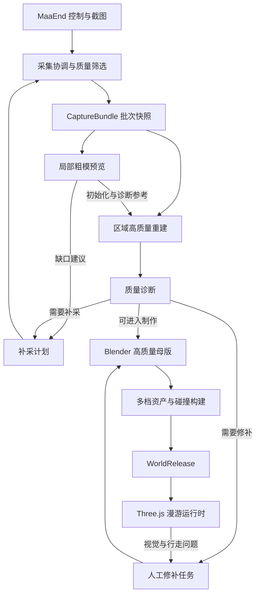
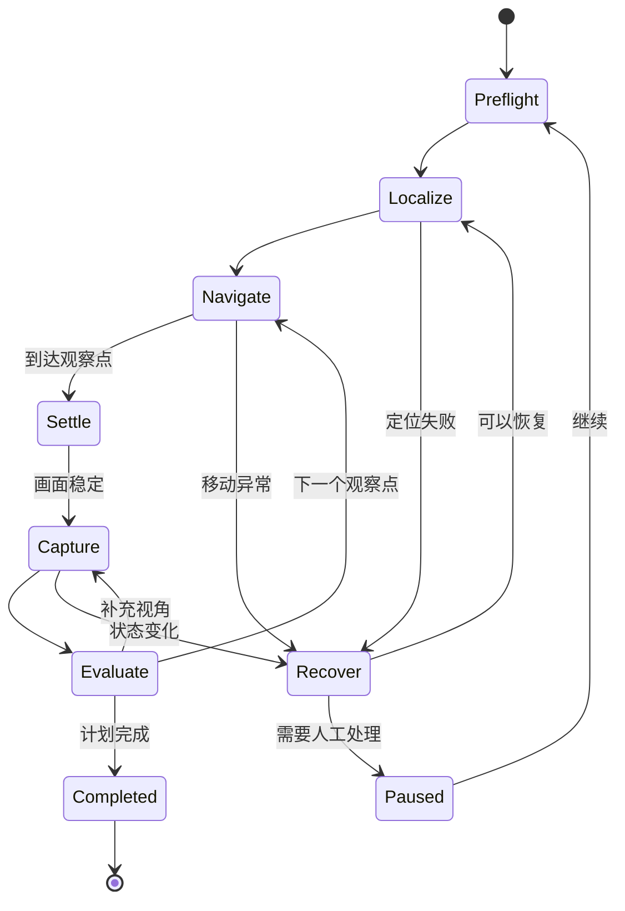

# 终末地自动采集、三维重建与 Web 漫游系统

## 完整架构方案与 GPT-6-Astra 设计输入 · V1.0

| 项目 | 内容 |
| --- | --- |
| 文档日期 | 2026-11-09（Asia/Shanghai） |
| 文档用途 | 汇总已讨论需求与技术判断，作为 GPT-6-Astra 深化架构和拆解实施任务的输入 |
| 采集器仓库 | `enfield-capture-maaend` |
| 网页漫游仓库 | `endfield-world-web` |
| 上游项目 | [MaaEnd/MaaEnd](https://github.com/MaaEnd/MaaEnd) |
| 源码调研基线 | `v2` 分支，提交 `8cccaaec8f59f4b4689b59db84a39d25066ff5ec` |
| 当前阶段 | 架构规划与静态源码调研；尚未执行游戏采集、重建实验或手机性能实测 |
| 最终产物 | 可在网页中浏览，并通过角色或摄像机在场景中自由移动的三维世界 |
| 本次补充 | 固定 Windows 连接运行中游戏采集、CLI 与一键脚本、离线跨机处理、独立网页及后续平台适配边界 |

> 本文中的两个仓库名称为用户指定的正式名称，后续文档、目录、依赖说明和设计输出均应保持一致。
>
> 最新范围调整：不将腾讯边缘节点、云套餐、免费额度或最终发行包体积作为架构约束，也不保留此前讨论中的发行体积目标。手机端运行流畅、高质量母版与逐级降级仍是核心要求。

> 2026-11-09 用户确认：本次授权在 RabbitStudioChino 账号 Fork / 创建下述两个仓库，并提交、推送架构及协议成果；本条替代本文中“尚未授权仓库写入”的旧阶段描述。详细设计见同目录 [详细架构](architecture.md)。

## 目录

1. 目标、范围与成功定义
2. 架构结论与关键决策
3. MaaEnd 可复用能力与改造边界
4. 总体架构、运行环境与数据流
5. 两个仓库的职责与组织方式
6. 自动采集系统
7. 数据契约、时间与坐标规范
8. 视觉重建流水线
9. Blender 母版与资产加工
10. Web 漫游系统
11. 手机性能与分级画质
12. 任务编排、恢复与可观测性
13. 主要技术难点与应对策略
14. 分阶段实施与验收
15. Git 工作流与开源边界
16. 待确定事项与默认假设
17. 交给 GPT-6-Astra 的设计任务
18. 参考资料

---

## 1. 目标、范围与成功定义

### 1.1 用户希望实现的完整链路

以 MaaEnd 的自动化能力为基础，自动控制《明日方舟：终末地》中的角色移动和镜头观察，采集足够的多视角画面，将画面重建为三维环境，经 Blender 整理后，在网页中提供可操作角色和摄像机的漫游体验。

最终用户应能够：

- 在桌面浏览器与手机浏览器中进入三维场景。
- 通过键盘、鼠标或触屏控制角色移动与镜头方向。
- 在已制作的区域内行走，获得基本可靠的地面、墙体、坡面与台阶碰撞。
- 使用适合设备的画质，并在不同区域之间连续移动。
- 在保留高质量制作母版的前提下，使用经过优化的运行资产。

### 1.2 必须保留的要求

| 编号 | 要求 | 架构含义 |
| --- | --- | --- |
| R01 | 复用 MaaEnd 的自动化基座 | 采集器以 Fork 为起点，复用输入、截图、定位和导航，减少重复开发 |
| R02 | 逐步实现自动跑图与自动采集 | 需要摄影采集状态机、覆盖规划、失败恢复及补采闭环 |
| R03 | 产物是真正可移动视角的三维环境 | 普通贴图网格是主线，不能以固定视角图片或全景切换替代 |
| R04 | 网页中可以控制角色或摄像机走动 | 模型展示之外还需输入、角色控制、碰撞、镜头和场景管理 |
| R05 | 手机运行流畅 | 需要可调画质、资源驻留管理、LOD、合理材质和渲染策略 |
| R06 | 尽可能保留较高精度母版，再逐步降级 | 原始采集数据、重建母版和运行资产分离 |
| R07 | 两个正式 GitHub 仓库 | 采集制作端与 Web 运行端通过版本化数据契约协作 |
| R08 | 供 GPT-6-Astra 进一步设计架构 | 区分已核实事实、建议方案、待验证假设，不把概念设计冒充已实现功能 |
| R09 | 分区域采集、分批异步重建 | 首版实现单区域批处理闭环；后续增加采集期间的粗模反馈、补采及多区域并行 |

### 1.3 对“像游戏一样操作”的定义

本项目首先实现的是接近游戏的空间操作方式：角色移动、相机旋转、地形碰撞和场景漫游。

这不自动包含原游戏的战斗、任务、交互机关、天气系统、物理规则和完整动画表现。网页中的角色模型、骨骼与动画需要单独提供，不能从环境截图重建中顺带获得。

建议首版以第三人称角色漫游为主要产品模式，提供自由摄像机用于浏览和制作检查；第一人称模式可复用相同世界与碰撞基础，后续加入。

### 1.4 对自动化与精度的正确预期

最终目标是对指定区域建立可重复执行的自动采集与制作流程。第一阶段从边界明确、可安全绕行的静态小区域开始，并保留人工规划观察点与修补资产的入口。

仅有 RGB 画面时，重建结果是基于可见证据的近似世界。未观察到的背面、屋顶、室内和遮挡区域缺少直接恢复依据；高质量母版也不能凭空补回未采到的信息。

以下内容不作为首期完成条件：

- 无人工干预地探索并完整恢复全部地图。
- 边跑图边实时生成高质量、可编辑、可碰撞的完整世界。
- 从屏幕画面恢复原游戏内部模型文件、原始材质参数或真实相机矩阵。
- 自动生成原游戏角色的完整骨骼、动画和技能。
- 建设账号、多人同步、云端 GPU 重建平台或复杂业务后台。

以上边界用于控制技术依赖，不降低后续逐步提高自动化程度的目标。

## 2. 架构结论与关键决策

### 2.1 主线方案

**MaaEnd 受控采集 → 图像预处理 → 相机估计与稀疏重建 → 稠密重建与网格化 → Blender 母版加工 → 多档运行资产 → Three.js 网页漫游。**

这里需要明确四层分工：

| 层级 | 责任 | 不应混淆的内容 |
| --- | --- | --- |
| 自动化控制 | 让角色到达观察点，并获得可用画面 | 导航成功不等于重建成功 |
| 视觉重建 | 从多视图估计相机与场景几何 | 单张图生成或相机猜测不等于多视图一致的世界 |
| 资产制作 | 整理网格、材质、碰撞、分块与画质派生资产 | 导出 GLB 不等于完成可漫游体验 |
| Web 运行 | 渲染、移动、碰撞、镜头、流式管理 | Three.js 不是自动摄影测量工具 |

### 2.2 Blender 与 Three.js 的选择

采用 **Blender 离线制作 + Three.js 在线运行**。

Blender 负责重建结果整理、人工修补、网格简化、UV 与纹理处理、碰撞代理制作以及批量导出。其 Python API 可用于自动化导出等工作。[S16]

Three.js 负责网页中的场景加载和渲染；glTF/GLB 通过 GLTFLoader 接入，所需扩展与解码器按实际资产配置。[S17]

对于具有明确规则的重复结构，可以在 Three.js 中程序化生成或实例化。但复杂环境重建仍以离线资产管线为主。用代码生成网格，并不会天然使相同几何与材质在 GPU 上更轻。

### 2.3 建议固定的技术决策

| 决策 | 建议 |
| --- | --- |
| 主场景表示 | 带纹理三角网格 |
| 基线重建 | COLMAP SfM + OpenMVS 稠密重建、网格、细化与纹理；通过适配器允许替换稠密后端 |
| 学习式几何 | 作为可替换的实验后端或初始化手段，不设为唯一依赖 |
| Gaussian Splatting | 可选外观预览或专项研究分支，不承担主碰撞与可编辑网格职责 |
| 制作工具 | Blender，人工编辑与 Python 批处理并存 |
| 运行资产 | glTF 2.0 / GLB、纹理、独立碰撞数据、世界清单 |
| Web 技术 | TypeScript + Three.js；页面建议使用 React + Vite，React Three Fiber 作为组织渲染层的候选 |
| 角色碰撞 | Rapier 运动学角色控制器作为基线 |
| Web 渲染基线 | WebGL2；WebGPU 作为后续可选路径，先验证目标手机兼容性 |
| 交互方式 | 桌面键鼠 + 手机双区触控；第三人称为首版主模式 |
| 任务执行 | 本地或工作站上的命令行/子进程流水线，按区域与不可变采集批次异步调度，支持中断恢复 |
| 建模更新方式 | 后续观测可以修正粗模；区域充分采集后生成正式模型，多个区域完成后显式对齐整合 |
| 初期服务端 | 静态资产服务即可，不以业务后端、数据库或在线推理为前提 |
| 版本管理 | 两个代码仓库；大型源素材与代码历史分开管理 |
| 再现性 | 固定上游提交、子模块版本、算法版本、模型权重版本和构建参数 |

这些是建议的架构基线。GPT-6-Astra 可以调整未被用户固定的实现选型，但应说明理由、影响范围与迁移成本。

## 3. MaaEnd 可复用能力与改造边界

### 3.1 调研结论

MaaEnd 适合作为“操作游戏并采集画面”的基础，但不等于已经拥有通用自主探索系统或三维重建管线。

以下结论来自指定提交的静态源码与项目文档分析，未经过游戏实机验证。

| 已有能力 | 调研到的入口 | 适合复用的部分 | 仍需新增 |
| --- | --- | --- | --- |
| 小地图定位 | `MapLocateRecognition`、MapLocator 文档 | 区域、平面位置、角色朝向、镜头水平朝向与定位置信信息 | 完整相机内参、六自由度相机位姿 |
| 自动导航 | `MapNavigateAction`、MapNavigator 文档 | 路线点、可走网格、移动及语义动作 | 面向观察覆盖、重叠与视差的采集计划 |
| 截图链路 | `PositionProvider::captureWith()` | MaaFramework 截图和小地图定位输入 | 原图持久化、帧编号、元数据与位姿观测配对 |
| 镜头操作 | 镜头转向、俯仰控制及扫描动作 | 输入控制与部分角度换算 | 摄影专用扫描、静止验证、标定与输入仲裁 |
| 导航辅助几何 | `BaseNavPack`、`OccluderPack` | 可走面、楼层与有限几何先验 | 完整外观几何、细节、UV 与材质 |
| 路线编辑工具 | `tools/MapNavigator` | 编辑、录制、试跑及导航几何预览 | 采集覆盖、质量诊断与重建资产工作流 |

来源：[S01]—[S11]。

### 3.2 导航观测不能直接当作相机真值

MapLocator 中的位置主要是地图全局像素坐标，镜头水平朝向也不是完整三维旋转。`NaviPosition.floor_y` 表达可走面高度信息，并非实测摄像机高度。[S01][S05]

第三人称相机还会受到角色偏移、跟随延迟、绕转、遮挡缩回和视野变化影响。因此：

- 导航观测用于控制、区域识别、轨迹粗先验与结果合理性检查。
- 重建相机参数从图像估计并优化，另行保存。
- 按键持续时间、鼠标拖动距离等属于输入指令，不能冒充实际相机位移。
- 导航坐标归一化、楼层变换与重建坐标对齐必须分别记录。

### 3.3 截图接入必须处理的源码细节

**帧观察者不是空闲插槽。** 现有 `setFrameObserver()` 会替换单一回调；导航状态机已经使用它向多个识别扫描器分发画面，停止扫描时还会清空回调。[S03][S04]

建议在现有分发链路增加订阅，或引入多订阅者帧总线，并保持原有识别行为。不能直接再注册一次回调覆盖上游逻辑。

**截图与定位必须绑定到同一帧。** 当前整帧 observer 在本次定位完成之前被调用；读取“最近一次定位”会把上一帧位置错误关联到当前图像。新采集器应在取帧时分配 `frame_id`，完成本次识别后，再发布联合结果。[S03]

**时间戳需要明确含义。** 当前导航位置中使用的是截图请求开始时的单调时钟，不是游戏原生渲染帧时间。新系统应分别保存请求、完成、识别结束时间；无法获取原生帧时间时明确记为未知。[S03]

**异步保存必须拥有图像内存。** 当前 `cv::Mat` 可能引用局部截图 buffer。进入异步队列前必须复制或转移明确拥有生命周期的数据，不能延后访问借用视图。[S03]

**失败要拆开记录。** 定位函数失败不一定意味着截图无效；可能只是朝向不足。截图、平面定位、角色朝向、镜头朝向和质量筛选应有独立状态。部分黑屏分支发生在 observer 之前，也需要单独记账。

### 3.4 导航转向不能直接作为摄影扫描

当前 `HEADING` 语义动作包含前移脉冲；它的目标是完成导航中的朝向调整，而非保证摄影测量时光心或角色位置不变。[S06]

应增加摄影专用“仅镜头操作”动作：

1. 暂停导航并释放移动输入。
2. 确认角色与画面稳定。
3. 执行镜头动作。
4. 通过新画面确认实际效果。
5. 采集后恢复导航所需状态。

已有俯仰输入映射可作为控制起点，但不应被理解成 FOV、相机高度或完整外参标定。[S07]

### 3.5 导航几何的使用边界

NavMesh、楼层与辅助遮挡数据可以帮助选择观察点、约束可走面和进行坐标对齐；它们不是完整游戏美术模型。[S10][S11]

特别注意：

- 导航数据里的平面坐标不一定是渲染模型纹理 UV。
- 粗几何不能代替完整建筑表面、细节和材质。
- 原游戏导航数据与网页导航数据并非天然同一个坐标系。
- 不依赖“直接读取游戏内存、渲染缓冲或解包资产”才能成立；如未来获得正式接口，应作为单独的数据源适配器接入。

## 4. 总体架构、运行环境与数据流

### 4.1 逻辑架构



图中的自动补采箭头有前提：必须能够把重建问题区域映射为游戏中可到达的观察点。映射尚未标定时，补采结果先以区域、参考帧和人工观察建议表达，不伪装成可直接执行的导航坐标。

### 4.2 执行环境

| 环境 | 运行内容 | 建议 |
| --- | --- | --- |
| 游戏采集机 | 正在运行的 Windows 游戏、MaaFramework、MaaEnd、采集扩展 | 首版固定 Windows，必须连接运行中的《明日方舟：终末地》 |
| 重建工作站 | 预处理、SfM/MVS、可选学习式几何 | 可与采集机同机，也可通过数据包跨机器运行 |
| 资产制作环境 | Blender、构建脚本与母版 | 与浏览器运行环境解耦 |
| 静态资源服务 | 网页、世界清单、运行资产 | 仅定义资源服务接口，不绑定具体服务商 |
| 用户浏览器 | 渲染、角色、碰撞、镜头与流式调度 | 桌面与手机分别适配输入和画质 |

首版采集器 `enfield-capture-maaend` 以 Windows 为主要运行平台，必须连接正在运行的《明日方舟：终末地》。使用 MaaFramework 及 MaaEnd 现有控制能力，提供 CLI 入口与一键启动脚本，具备采集任务控制、停止、恢复和日志记录功能。不要求独立 Windows GUI；游戏未运行或连接失败时明确失败，不以模拟采集替代。

COLMAP、OpenMVS、Blender 作为独立离线处理流程，可与 Windows 采集机同机运行，也可将完整数据包转移到 Mac、Linux 或其他工作站。具体后端及 GPU 支持按安装版本核验，不保证所有平台拥有相同加速能力。

网页 `endfield-world-web` 完全独立于游戏客户端和 MaaEnd。访客只需打开网页，即可加载已经重建并发布的世界，控制角色与摄像机；无需运行游戏、采集器或离线工具。

保留 MaaEnd 现有控制器架构，将 Windows 接口限制在控制器适配层，不扩散到采集业务。macOS、PlayCover、ADB 等保留为后续可选适配，不作为首版必须实现或验收的目标。

### 4.3 运行方式：分区域、分批异步重建

**最终采用“采集时检查与局部粗重建、区域数据充分后正式建模、多个区域完成后全局整合”的方式。第一版先跑通单区域采完后批处理的闭环，后续再启用采集期间的增量预览与补采反馈。**

采集批次以观察点、路段或小区域组织，不要求整张地图全部采完才开始建模。角色移动本身不直接触发一次完整建模；是否更新由有效多视角观察、图像重叠与视差、区域覆盖和计算资源共同决定。

| 工作 | 执行时机 | 主要产物 | 实施阶段 |
| --- | --- | --- | --- |
| 采集与轻量检查 | 角色移动、停稳和扫描时 | 原图、观测、质量标记与有效帧 | 首版实现 |
| 局部粗重建 | 新增有效关键帧形成完整提交的批次后 | 相机轨迹、稀疏点云或粗几何、覆盖诊断 | 后续增量能力 |
| 区域高质量重建 | 区域有效观察充分，或进入明确的人工检查节点时 | 稠密几何与纹理网格 | 首版按单区域批处理 |
| Blender 加工与导出 | 区域模型通过相应检查后 | 母版、碰撞体、多档运行资产 | 首版实现 |
| 跨区域整合 | 相邻区域具备公共观察与对齐依据后 | 统一坐标、尺度与接缝的场景 | 多区域扩展阶段 |

局部粗模服务于制作诊断，允许被后续观测修改或重算。正式漫游运行时只使用已经验收的 WorldRelease，不能把每次粗模变化立即替换成正式碰撞与场景资产。

### 4.4 多区域流水线与资源调度

例如先采集区域 A，A 的数据形成批次后交给后台重建；采集器可以继续进入 B。后台检查 A 后提出缺口建议，采集协调器在适当切换点安排补采；新增数据形成新批次，再更新 A 的重建。区域 C 也可以按相同方式加入。

并行是可选择的执行方式，不是实时性保证：

- 游戏、截图和输入控制优先占用保障其响应所需的资源。
- 粗重建、正式重建和 Blender 任务在独立子进程或工作站运行，不进入导航回调。
- 同机资源不足时，降低预览频率、合并待处理批次或将重建延后执行。
- 每个区域同一分支上的更新按依赖顺序提交；不同区域在资源允许时可以并行。
- 队列采用有界积压与背压，不因追求同时运行而无限占用内存。
- 已完成区域可先独立预览；形成连续漫游世界前，仍需统一坐标、尺度、碰撞和区域接缝。

第一版允许使用同一套任务接口串行执行，不为异步能力引入额外网络服务或复杂任务平台。

## 5. 两个仓库的职责与组织方式

### 5.1 `enfield-capture-maaend`

该仓库从 MaaEnd Fork，负责自动采集与离线制作链路。

核心职责：

- 对接上游控制、定位、导航与截图能力。
- 采集计划、摄影镜头控制、状态机和异常恢复。
- 原始数据、采集清单和重建输入的生成。
- 调用重建后端并输出统一中间结果。
- 调用 Blender 批处理脚本，维护母版加工与导出流程。
- 输出符合 Web 协议的世界发布资产。
- 提供制作端的采集进度与诊断入口。

建议新增逻辑目录如下，实际位置由 GPT-6-Astra 在阅读上游构建与注册方式后确定；不要求重排整个上游仓库：

| 建议路径或模块 | 内容 |
| --- | --- |
| 现有 agent 内的采集扩展模块 | `CaptureCoordinator`、输入仲裁、帧总线、摄影动作 |
| `tools/capture/` | 会话管理、计划生成、数据检查与导出 |
| `tools/reconstruction/` | 预处理、后端适配器、区域/批次调度、粗模预览、区域对齐、质量报告 |
| `tools/blender/` | 导入、清理、烘焙、碰撞、多档导出脚本 |
| `tools/world-export/` | 读取 Web 发布协议并生成 WorldRelease |
| `contracts/capture/` | 采集与重建输入协议、样例、版本说明 |
| `docs/capture/` | 数据采集、标定、恢复及操作说明 |

上游性能敏感的 C++ 取帧与导航循环保持轻量；离线编排优先采用 Python 和工具 CLI。不能把神经重建或 Blender 执行塞进导航回调。

### 5.2 `endfield-world-web`

该仓库独立创建，负责浏览器中的世界加载与交互。

建议逻辑模块：

| 建议路径 | 内容 |
| --- | --- |
| `src/app/` | 页面、场景选择与运行状态界面 |
| `src/runtime/world/` | 世界、区域与空间索引 |
| `src/runtime/assets/` | 加载、解码、共享资源与生命周期 |
| `src/runtime/streaming/` | 分块调度、优先级、取消与卸载 |
| `src/runtime/rendering/` | 材质、灯光、LOD 与渲染设置 |
| `src/runtime/physics/` | 碰撞世界、角色运动与地面判断 |
| `src/runtime/character/` | 角色外观、动作状态和动画 |
| `src/runtime/camera/` | 第三人称、自由摄像机与避障 |
| `src/runtime/input/` | 桌面与触屏输入归一化 |
| `src/runtime/quality/` | 设备档位、运行时性能反馈与降级 |
| `contracts/world/` | 世界发布协议及运行时兼容规则 |
| `tools/asset-validation/` | 发布清单与实际资产的一致性检查 |
| `public/demo/` 或外部资产目录 | 小型、自有或明确可使用的示例场景 |

这些路径描述模块边界，不代表现在已经存在对应实现。

### 5.3 协议归属与跨仓库依赖

建议按生产环节划定协议主版本来源：

| 协议 | 权威定义位置 | 使用者 |
| --- | --- | --- |
| CaptureBundle、采集帧记录、采集计划 | `enfield-capture-maaend/contracts/capture/` | 采集、预处理、重建 |
| ReconstructionBundle、PreviewSnapshot、RescanRequest | 采集器仓库中的对应协议目录 | 重建、制作预览、Blender、补采规划 |
| WorldRelease、SceneManifest、AssetDescriptor | `endfield-world-web/contracts/world/` | 离线导出器、浏览器加载器 |
| 坐标与转换约定 | 写入各协议的公共约定，使用明确版本与转换标识 | 全链路 |

WorldRelease 的导出器使用 Web 仓库发布的固定版本 schema 制品；不动态依赖对方的最新分支，不在运行时拉取另一仓库代码。

初期采用 JSON Schema、样例和固定版本依赖即可。需要时再生成 TypeScript/Python 类型，不为协议管理新增第三个仓库或分布式服务。

协议变更必须记录兼容范围。未知 major 版本拒绝加载并给出清晰原因；兼容的新增字段允许忽略。字段删除、含义变化、坐标约定变化不能静默处理。

### 5.4 代码与素材分开管理

代码仓库保存源码、配置、schema、脚本和小型示例。

原始图像、录屏、重建缓存、完整母版和大型实验产物保存在独立数据工作区，并通过清单引用。通过忽略规则排除本地缓存、临时文件和无关产物，避免进入日常代码提交。

每份发布资产保留来源会话、重建任务、母版版本和导出参数。分开保存不意味着丢失来源关系。

## 6. 自动采集系统

### 6.1 模块划分

| 模块 | 核心责任 |
| --- | --- |
| `CaptureCoordinator` | 会话、区域、路段、观察点及摄影采集状态机 |
| `InputArbiter` | 在导航、镜头扫描和恢复逻辑之间分配唯一输入控制权 |
| `SurveyPlanner` | 选择可到达观察点，规划平移、回看、环绕和相邻区域重叠 |
| `CameraController` | 摄影专用转向、俯仰、停稳确认及操作校准 |
| `CaptureFrameBus` | 图像、时间、定位和事件的同帧关联，轻量多订阅分发 |
| `VisualQualityGate` | 模糊、黑屏、遮挡、重复、曝光变化等质量判断 |
| `CaptureWriter` | 有界异步队列、图像编码与落盘、完整性记录 |
| `RecoverySupervisor` | 失锁、卡住、过图、战斗、掉落、写入积压与用户中断 |
| `SessionExporter` | 冻结并导出可复现的采集数据包 |
| `CalibrationRegistry` | 画面配置、镜头模式、内参先验与坐标转换版本 |

### 6.2 采集状态机



实现还应支持任意活动状态下的用户暂停、终止和安全释放输入，不必把所有边画入状态图。

### 6.3 观察路径设计

沿路快速跑一遍并不足以保证可重建。采集规划应优化“同一表面被多个有效视角观察”的程度，而不仅是路线长度。

建议：

- 对墙体和建筑立面安排侧向移动和回看。
- 对独立物体安排可到达范围内的环绕观察。
- 对前后遮挡明显的区域增加不同距离或高度的观察点。
- 相邻区域保留公共地标和重叠观察，便于后续拼接。
- 采用关键帧策略控制冗余，并记录被拒绝的原因。
- 路径经过、有效帧覆盖和几何覆盖分别统计。

COLMAP 官方建议多视角、高重叠且包含位置变化的采集。[S12] 第三人称绕角色转镜头可能使相机光心移动，不能简单认定所有原地转镜头都无效；但实际平移基线不足时，仍需主动换位置。

首版支持人工选观察点并自动执行。后续再增加基于粗模型、可走网格和覆盖缺口的自动规划。

### 6.4 画面设置与有效区处理

在游戏正常提供的设置范围内，尽量固定分辨率、镜头模式、视野和影响重建的后处理。能否隐藏 HUD、关闭运动模糊或稳定时间光照，应通过实机确认，不能当作现成能力。

每帧可维护以下有效区：

- 静态场景可用区。
- HUD 与固定屏幕元素遮罩。
- 玩家角色遮罩。
- NPC、特效和其他动态对象遮罩。
- 水面、透明、反射等难重建区域标记。

原图始终保留。预处理图、遮罩及其来源独立存储，不能覆盖原始证据。逐帧生成式补图不进入默认重建输入；缺口优先通过其他视角补采。

遮罩必须经过各后端适配器显式传递。特征提取阶段忽略某一区域，不代表稠密重建、纹理投影或 Gaussian 训练也自动忽略。

### 6.5 数据采集与导航之间的背压

截图回调只做必要关联和入队，编码、写盘与重建在其他任务中完成。

写入队列接近容量时：

1. 降低摄影采样频率或暂停新增采样。
2. 保留导航和输入释放的响应能力。
3. 记录未采、丢弃或延迟的帧区间。
4. 根据缺口重新安排观察点。

不能通过无限扩张内存队列维持表面的采集速度，也不能让写盘阻塞使角色失控。

### 6.6 恢复与分段

| 事件 | 处理原则 |
| --- | --- |
| 短暂定位失败 | 保留图像状态，暂停依赖精确位置的动作，受控重定位 |
| 过图、传送、复活或严重位置跳变 | 新建轨迹片段，禁止跨断点插值 |
| 卡住与脱困 | 标记恢复区间；重新停稳与定位后继续有效采集 |
| 战斗或大面积动态遮挡 | 暂停正常观察采集，记录事件并等待恢复 |
| FOV、分辨率或相机模式变化 | 新建标定组，并评估是否切分片段 |
| 无法可靠到达 | 记录不可达与原因，不将盲走结果计为已完成覆盖 |
| 用户中断 | 释放按键和指针状态，提交检查点；继续时重新确认现场 |
| 进程退出或写入失败 | 保留已提交记录，排除未完整写入文件，从确认完成的观察点恢复 |

路线执行完成、有效图像收集完成、重建质量通过应是三个独立状态。

## 7. 数据契约、时间与坐标规范

本节字段是建议设计，不是 MaaEnd 当前已有的 API。GPT-6-Astra 应将其整理为正式 schema，并补充必填规则、枚举、错误语义与兼容约定。

### 7.1 主要数据包

| 数据包 | 输入或来源 | 最低内容 | 去向 |
| --- | --- | --- | --- |
| CapturePlan | 用户选区、观察点、可走信息 | 区域、路段、观察点、镜头计划、采集条件、恢复策略 | 采集器 |
| CaptureBundle | 一次或多次采集会话 | 原图、帧索引、不可变批次清单、时间、观测、事件与版本 | 重建流水线 |
| ReconstructionBundle | 指定区域、批次与算法版本 | 相机、稀疏/稠密结果、网格、纹理、对齐变换、质量报告、修订关系 | Blender 与补采诊断 |
| PreviewSnapshot | 某个已完成的局部粗重建修订 | 区域、输入批次、粗几何、相机、覆盖诊断与坐标版本 | 制作端预览组件 |
| RescanRequest | 重建或人工诊断 | 缺失区域、参考帧、期望观察方向、可执行性状态 | 采集规划 |
| MasterAssetSet | 重建结果与编辑记录 | Blender 母版、修补层、材质、锚点和源数据关联 | 运行资产构建 |
| WorldRelease | 指定母版与导出配置 | 世界清单、渲染资源、碰撞、角色引用、画质档与版本 | Web 漫游 |

正式网页漫游运行时只需要 WorldRelease，不应理解 MaaFramework 任务句柄、采集日志格式或 MaaEnd 内部 Pipeline。制作端预览组件可以读取独立的 PreviewSnapshot；预览协议由采集器仓库维护，不将其视为已验收的可行走场景。

### 7.2 CaptureBundle 的建议内容

| 文件或目录 | 含义 |
| --- | --- |
| `session.json` | 会话身份、版本、采集环境、游戏及镜头设置、时钟说明 |
| `plan.json` | 实际使用的采集计划及修订号 |
| `frames.jsonl` | 逐帧记录，按 frame_id 关联图像和观测 |
| `batches/` | 已完整提交的采集批次清单，引用稳定 frame_id 与文件哈希 |
| `events.jsonl` | 输入、状态切换、中断、恢复与丢帧事件 |
| `images/raw/` | 不被后处理覆盖的原图 |
| `images/derived/` | 去畸变、裁切或缩放后的派生图 |
| `masks/` | 遮罩与其生成版本 |
| `calibration/` | 镜头参数先验、标定分组与图像变换 |
| `checksums.json` | 已完成文件的内容校验 |
| `report.json` | 有效帧、失败原因与采集覆盖摘要 |

原始记录可采用追加写入，但已提交记录应保持不可变。补充识别与质量计算作为关联记录或新版本产物保存，不回写伪造原始观测。

异步重建只消费已完整提交的批次快照，不直接扫描仍在写入的图像目录。一个会话可以继续产生后续批次，不需要为启动局部重建而结束整个会话。

批次清单建议记录 batch_id、region_id、input_revision、frame_ids、图像与观测哈希、标定版本以及提交状态。重叠帧可以被多个批次引用，不必复制原图，也不把每帧强行归属于唯一批次。

重建结果和预览保存 reconstruction_revision、parent_revision、input_batch_ids、world_frame_id 与质量状态。后续新增观察或配准修正产生新修订，不能静默覆盖此前结果或已验收母版。

### 7.3 帧记录字段

| 分组 | 建议内容 |
| --- | --- |
| 身份 | schema_version、session_id、segment_id、frame_id、waypoint_id |
| 时间 | 截图请求、截图完成、识别完成的单调时间；会话 UTC 锚点 |
| 时间质量 | 来源类型、是否有原生帧时间、后端延迟是否已校准 |
| 图像 | 相对路径、内容哈希、宽高、像素格式、来源后端 |
| 图像变换 | 裁切、缩放、去畸变及其版本 |
| 导航观测 | 区域、原始位置、归一化位置、楼层、坐标系、观测状态与置信信息 |
| 方向观测 | 角色朝向、镜头水平朝向，分别注明单位、方向约定及状态 |
| 控制状态 | 当前输入所有者、导航/采集/恢复阶段、关联输入事件 |
| 质量 | 黑屏、模糊、遮挡、重复、有效区、选帧结果与原因 |
| 来源 | 上游提交、子模块提交、采集器版本、游戏版本和配置摘要 |

不能获得的值使用 `null` 或明确的缺失状态，不以零值填充。每种置信分数注明来源与定义，不混合成没有解释的“统一准确率”。

以下 JSON 仅演示字段组织，数值是示例，不代表实测：

```json
{
  "schema_version": "capture.frame/1.0",
  "session_id": "example-session-001",
  "segment_id": "segment-001",
  "frame_id": "frame-000012",
  "waypoint_id": "viewpoint-a03",
  "timing": {
    "clock_id": "capture-process-001",
    "request_monotonic_ns": "12000000000",
    "complete_monotonic_ns": "12045000000",
    "locate_complete_monotonic_ns": "12071000000",
    "native_render_timestamp": null,
    "timestamp_source": "host_capture_api"
  },
  "image": {
    "uri": "images/raw/frame-000012.png",
    "width": 1920,
    "height": 1080,
    "status": "captured"
  },
  "navigation_observation": {
    "coordinate_frame_id": "example-map-frame",
    "zone_id": "example-zone",
    "position_xy": null,
    "position_unit": "map_pixel",
    "position_status": "unavailable",
    "character_heading": null,
    "camera_yaw": null,
    "floor_height": null
  },
  "control": {
    "owner": "capture",
    "state": "settled_capture",
    "input_event_ids": []
  },
  "camera_estimate_ref": null,
  "quality": {
    "selection_status": "pending",
    "mask_refs": [],
    "rejection_reasons": []
  }
}
```

该示例刻意允许“截图有效、导航观测缺失”，避免把二者绑定成同一个成功标志。完整记录还需加入哈希、标定引用和版本来源。

### 7.4 时间语义

- 同一进程内用单调时钟排序，防止系统校时影响时序。
- 会话保存 UTC 锚点；跨进程或重启后更换 clock_id，记录映射关系与不确定性。
- 纳秒级时间可用十进制字符串表示，避免 JavaScript 数值精度损失。
- 请求与完成时间描述主机端操作过程，不自动构成游戏渲染时间的严格上下界。
- 原生帧时间不可得时，不能宣称精确到渲染帧的输入—图像同步。
- 输入完成只代表调用或执行阶段结束，是否到位仍需画面确认。
- 优先从同一张原图派生小地图定位与重建输入；如使用独立截图通道，额外保存关联方法与误差。
- 过图、传送、重连和相机模式突变必须形成显式断点。

### 7.5 原始观测与重建结果分离

重建结果通过 frame_id 关联，建议单独保存：

- camera_model 与 calibration_group_id。
- 相机内参、畸变、处理后图像尺寸。
- 明确方向命名的变换，例如 `T_world_from_camera`。
- 位姿估计方法、求解器版本、配置与质量信息。
- world_frame_id、尺度状态与对齐变换。
- 注册失败、被排除或所属连通分量等状态。

不能用优化后的相机位置覆盖原来的小地图观测，也不能将算法估计改名为“游戏真实坐标”。

### 7.6 坐标系统

至少明确以下坐标域：

| 坐标域 | 内容 | 主要注意事项 |
| --- | --- | --- |
| 图像坐标 | 像素与有效画面 | 左上原点、尺寸和像素中心约定需统一 |
| MaaEnd 导航坐标 | 地图像素、区域和楼层 | 保留原始与归一化版本，不直接视为米制三维坐标 |
| 重建局部坐标 | 每个重建分量的点、相机 | 初始方向与尺度可能任意 |
| 规范世界坐标 | 已对齐场景、出生点、碰撞 | 右手系，+Y 向上，稳定原点和 world_frame_id |
| Blender 制作坐标 | 编辑母版 | 通常 Z 向上，转换仅在明确适配层进行 |
| 发布资产局部坐标 | 分块、角色和道具 | 通过声明的变换关联规范世界 |
| Web 相机局部坐标 | 浏览器视图 | 明确相机朝向约定，不能直接照搬 COLMAP 外参 |

发布资产遵循 glTF 的坐标与单位约定；尺度还必须注明来源。glTF 的米制单位并不证明输入重建已经恢复真实物理尺度。[S22]

建议 `scale_status` 至少包含：

- `arbitrary`：尚未建立可信距离参照。
- `estimated`：根据几何或人工参照估计，但未充分验证。
- `verified`：使用可信参照完成验证，并记录方法与误差。

需要在网页中获得合理操作体验时，可以采用明确标注的估计尺度。不能把“角色看起来合适”当作恢复原游戏绝对尺度的证明。

### 7.7 COLMAP 到规范世界的转换

COLMAP 输出外参使用世界到相机的形式：

\[
x_{cv}=RX+t,\qquad C=-R^\mathsf{T}t
\]

其相机局部轴向为 X 向右、Y 向下、Z 向前；输出四元数为 WXYZ。相机中心是 C，不能把 t 直接当作相机世界位置。[S13]

令重建世界到规范世界的相似变换为：

\[
X'=sR_aX+t_a
\]

再令相机基底转换为：

\[
D=\operatorname{diag}(1,-1,-1)
\]

则适配到沿局部 -Z 观察的相机约定时，可使用：

\[
C'=sR_aC+t_a,\qquad
R'_{camera\to world}=R_aR^\mathsf{T}D
\]

实现必须进一步固定矩阵是行主序还是列主序、矩阵乘法方向，以及序列化四元数使用 XYZW 还是其他顺序。所有适配器经过同一组轴向与锚点样例检查。

区域对齐失败时保留各自局部坐标，不能仅按包围盒位置拼接并宣称完成全局对齐。

### 7.8 图像变换与内参

任何裁切、缩放或去畸变都必须保存映射，并相应更新内参。若以二维齐次变换 A 表示裁切与缩放，可按约定计算处理后内参 `K' = A K`；去畸变还需要对应相机模型处理。

HUD 隐藏、摄影模式或界面切换可能改变有效画幅与小地图可用性。此类模式切换同时影响控制与标定，应有显式状态，不能仅当作去掉一张 UI 贴图。

### 7.9 WorldRelease 建议内容

WorldRelease 是一个有版本的完整逻辑发布单元，不要求它对应单个文件。

最低内容：

- manifest/schema 版本、scene_id、release_id。
- world_frame_id、轴向、单位、尺度来源与可漫游边界。
- 区域清单、包围盒与局部到世界变换。
- 渲染网格、材质纹理与共享资源引用。
- 质量档及各档内部的 LOD 选择信息。
- 独立碰撞资源及生效区域。
- 出生点、角色资源与镜头初始配置。
- 资源内容哈希、依赖、必要解码能力与构建来源。
- 可选导航数据、人工补全部分和低置信区域标记。

首版允许只有一个区域、一个手机档位和一个占位角色。接口为后续扩展保留空间，不等于第一版必须实现全部流式功能。

下面是结构示意，资源名、坐标和哈希占位符均需由构建器替换：

```json
{
  "schema_version": "world.release/1.0",
  "scene_id": "example-courtyard",
  "release_id": "example-release-001",
  "world_frame": {
    "id": "example-world-frame-v1",
    "handedness": "right",
    "up_axis": "+Y",
    "unit": "meter",
    "scale_status": "estimated",
    "scale_reference": "calibration/example-scale.json"
  },
  "spawn": {
    "position": [0, 1, 0],
    "rotation_xyzw": [0, 0, 0, 1]
  },
  "profiles": ["mobile", "balanced", "high"],
  "chunks": [
    {
      "id": "courtyard-a",
      "bounds_world": {
        "min": [-10, -2, -10],
        "max": [10, 8, 10]
      },
      "transform": {
        "position": [0, 0, 0],
        "rotation_xyzw": [0, 0, 0, 1],
        "scale": [1, 1, 1]
      },
      "render_variants": {
        "mobile": ["courtyard-a-mobile-lod0"],
        "balanced": ["courtyard-a-balanced-lod0"],
        "high": ["courtyard-a-high-lod0"]
      },
      "collision_asset_id": "courtyard-a-collision",
      "neighbors": [],
      "shared_dependencies": []
    }
  ],
  "asset_index_uri": "assets/index.json",
  "character_asset_id": "placeholder-character"
}
```

正式 schema 需定义 LOD 数组的顺序和阈值语义、出生点使用脚底还是胶囊中心，以及 bounds 与 transform 的关系。上例仅给出字段组织，不代替这些约定。

资源索引至少记录 ID、类型、URI、内容哈希、依赖和所需扩展。正式发布前验证引用闭合，防止清单中存在缺失资源。路径解析和资源请求应受发布目录或配置的资源根约束。

## 8. 视觉重建流水线

### 8.1 基线处理步骤

| 阶段 | 输入 | 输出 | 主要失败条件 |
| --- | --- | --- | --- |
| 数据检查 | CaptureBundle | 可处理会话与问题清单 | 文件缺失、配置不明、图像损坏 |
| 关键帧筛选 | 原图与观测 | 关键帧、有效区、分组 | 模糊、重复、动态遮挡 |
| 特征与匹配 | 有效图像 | 匹配与几何验证结果 | 纹理不足、重复结构、重叠不足 |
| SfM | 图像与匹配 | 相机、稀疏点云与连通分量 | 注册失败、轨迹漂移、错误匹配 |
| 稠密重建 | 相机与图像 | 深度、稠密点云 | 反射、透明、视差不足、显存不足 |
| 网格与纹理 | 稠密结果与来源图 | 可进入制作的纹理网格 | 孔洞、浮层、纹理接缝 |
| 区域对齐 | 重叠区域与锚点 | 全局变换与误差报告 | 尺度不一致、重复地标误配 |
| 质量诊断 | 几何、相机、独立检查视角 | 通过、补采、修补或不可重建状态 | 外观与空间结构不可信 |

SfM 输出相机与稀疏结构，MVS 及后续网格化才进入稠密几何阶段；不能把 `cameras/images/points3D` 文件称为最终场景模型。[S12][S13]

### 8.2 推荐基线及替换边界

首版推荐：

1. COLMAP 完成特征、匹配、相机估计与稀疏重建。
2. 通过适配器向 OpenMVS 提供其需要的相机、图像和稀疏结构。
3. OpenMVS 完成稠密点云、网格、细化和纹理流程。
4. 将统一 ReconstructionBundle 交给 Blender。

OpenMVS 官方说明其管线覆盖稠密点云、网格、细化与纹理。[S14] 具体可执行文件、格式转换、参数与 GPU 支持需按选定版本核实，不能把不同工具的文件目录机械拼接。[S30]

COLMAP 自身稠密流程可以作为替代后端。首版先跑通一条基线，不同时实现所有组合。

### 8.3 学习式几何分支

可以研究 VGGT 等方法用于相机/深度初始化、困难片段粗模或交叉验证。VGGT 官方提供了与 COLMAP 格式关联的导出流程，但输出仍是估计。[S15]

接入条件：

- 相机约定、图像变换、尺度和置信输出可以转换到统一契约。
- 真实游戏样本上的结果优于或补足当前基线。
- 运行环境、模型权重许可和计算资源能够满足使用方式。
- 失败时不破坏原始数据，能够回退到基线或人工处理。

不将“模型能从少量图片生成三维”直接等同于大场景几何准确、可碰撞或可编辑。

### 8.4 Gaussian Splatting 的位置

Gaussian Splatting 可作为外观预览、重建诊断或独立高保真展示分支；它表达的新视角外观与清洁三角网格、碰撞结构属于不同问题。[S31]

主线不依赖将 splat 自动转换成可用游戏资产。若后续研究 SuGaR 等网格提取方法，应单独验证拓扑、薄结构、碰撞和手机表现，再决定是否接入。[S32]

网页如果增加 splat 模式，需要专门渲染路径和独立性能策略，不能把所有 splat 数据默认交给普通 GLB 三角网格加载逻辑。

### 8.5 动态物体、反射与未知区域

对以下内容设置专门处理策略：

- 玩家、NPC 和粒子：遮罩或剔除，不将动态轨迹融合成环境。
- 水、玻璃和镜面：可能需要人工代理几何与材质。
- 植被：视稳定程度采用重建、替代资产或远景表达。
- 遮挡背面与封闭室内：先补采；无法观察时保留未知状态。
- 重复窗户、栅格和走廊：增加几何验证和区域约束，防止错误拼接。

如果为了漫游完整性增加地面、墙面或远景，应标注来源类别，例如 observed、inferred、manual，而不是把所有资产都描述成忠实恢复。

### 8.6 外观纹理不等于真实 PBR 材质

截图已经混入灯光、阴影、雾、曝光与后处理。由截图投影出的颜色往往带有照明信息，不能直接称为原始反照率、粗糙度或金属度。

初版可以采用外观优先的烘焙色或弱光照材质，避免把已有阴影再次叠加。需要动态昼夜或强动态灯光时，将材质重建作为独立任务处理。

Blender 和网页之间应固定色彩空间、曝光与色调映射策略，并使用参考视角检查外观差异。

### 8.7 重建质量与补采闭环

质量报告至少包含：

- 帧注册率和未注册原因。
- 稀疏模型连通性、相机轨迹合理性。
- 重投影误差分布与异常值。
- 关键表面的视角数量、角度分布及局部空洞。
- 区域对齐误差、锚点一致性。
- 未参与重建的检查视角上的外观与几何问题。
- 需要补采、人工修补或暂不可处理的区域。

不以单一重投影误差或一张好看的渲染图作为通过标准。

RescanRequest 需要区分：

- `executable`：已映射到有效导航坐标，可以自动执行。
- `needs_mapping`：有重建问题区域，但缺少到游戏导航空间的可靠映射。
- `manual_review`：建议人工选择观察点或修补。

二维小地图坐标与三维重建坐标之间可能涉及楼层和非唯一对应，不能假设一个通用比例就能覆盖所有区域。

粗模提出的缺口是带来源和质量说明的建议。只有导航映射与可到达性可靠时，采集协调器才将其纳入可执行补采计划；重建任务不能绕过输入仲裁直接操作游戏。

### 8.8 局部增量更新与区域正式建模

本项目中的“增量”首先表示工作流可以持续接收新批次、更新局部结果并保留修订关系，不保证所有重建后端都能逐帧在线更新。

建议分两层实现：

- **局部预览更新**：对新增有效观察进行相机注册或局部粗重建，输出可修改的 PreviewSnapshot 与覆盖诊断。
- **区域正式重建**：区域数据充分后，使用该区域已提交的有效数据进行完整优化、稠密重建、网格和纹理处理，再交给 Blender。

后端支持可靠的增量状态恢复时可以复用状态；不支持时允许对受影响区域重新执行批处理。通过接口隔离这两种实现，不能仅因算法名称包含“增量”就假设已具备实时系统能力。

更新触发条件应包含新增有效观察、视角重叠、位置变化和覆盖价值。可以设置时间间隔用于合并任务或避免过密调度，但不能只根据角色步数、鼠标动作次数或定时器宣布具备重建条件。

后续观察可能修正旧相机、旧点云和区域变换。因此：

1. 原始数据保持不变，粗模和优化结果以新修订保存。
2. 过期任务完成时，不得覆盖较新且已接受的结果。
3. 跨区域配准引起坐标变化时，标记受影响的渲染、碰撞、出生点和导出结果需要更新。
4. 预览检查通过不等于正式资产验收通过。
5. Blender 以区域级结果为加工单位，不在每新增一帧或角色每走一步时执行完整建模与导出。

## 9. Blender 母版与资产加工

### 9.1 母版应保存什么

母版包含高质量几何、纹理、重建相机、区域锚点、源帧引用、人工修补层及导出参数。

母版的目标是保存当前证据支持的较高质量结果，并允许重复派生运行资产。它不要求手机加载，也不以最终运行配置反向限制源数据质量。

建议将以下内容分为明确 Collection 或资产层：

- 重建原始结果。
- 清理后的制作母版。
- 人工修补与替代模块。
- 碰撞代理。
- 区域边界、锚点与出生点。
- 导出用不同质量集合。

### 9.2 资产加工步骤

1. 导入重建网格、相机和对齐变换。
2. 清理离群片、浮层、退化面和明显错误连接。
3. 检查地面、墙体、门洞和薄结构。
4. 修补必要缺口，保留修改来源。
5. 整理 UV、纹理接缝、材质与颜色。
6. 按空间和可见性划分区域，保留边界一致性。
7. 在适用时将重复结构替换为可复用模块。
8. 构建独立碰撞代理与必要的漫游边界。
9. 从母版生成质量档和 LOD。
10. 导出运行资产、元数据和构建报告。

Blender Python 用于可重复步骤，复杂语义分割、缺口修补和视觉判断保留人工入口。不能把“能调用 Blender”理解成所有资产制作都自动完成。

### 9.3 四类资产分离

| 类型 | 目的 | 关键要求 |
| --- | --- | --- |
| 渲染网格 | 呈现场景外观 | 支持材质、分块和细节级别 |
| 碰撞代理 | 角色行走与镜头避障 | 简化、连续、尺度正确，不随视觉 LOD 随意改变 |
| 导航数据 | 可选自动寻路或引导 | 以网页世界的可走区域为依据 |
| 角色资产 | 可操控角色与动作 | 独立模型、骨骼、动画和朝向约定 |

手动控制角色不要求先生成全场景 NavMesh。需要点击寻路、NPC 或自动导览时再增加该层。

原游戏采集画面中的玩家属于遮挡对象；网页角色应从独立资产来源获得。首版使用占位角色和基本待机、行走、跑步动画即可验证控制链路。

### 9.4 高质量到多档资产

每个档位原则上直接从母版派生，避免在已经多次减面、压缩的文件上继续加工导致误差累积。

降级策略按资产类型制定：

- 建筑保留主要轮廓、门洞和可行走结构。
- 管线、栏杆等薄结构单独处理，避免统一减面比例。
- 远景降低几何与材质复杂度。
- 纹理分辨率按可见重要性与屏幕投影大小确定。
- 角色减少不必要的材质、骨骼或动画数据时，验证动作表现。
- 可重复物体尽量共享几何和材质。

减少三角形、降低着色复杂度、压缩纹理和压缩几何属于不同操作，不以“导出文件变小”代替运行性能验证。

### 9.5 人工修补与重新构建

人工修改应当能被识别和保留：

- 记录被修补的资产 ID、来源母版版本与修改说明。
- 重建新版本先进入新产物目录，不直接覆盖已验收母版。
- 基础网格、区域坐标或尺度变化时，评估修补层是否还能沿用。
- 需要重新对齐时生成明确待办，而不是静默合并错位内容。

### 9.6 构建可重复性

每次导出记录：

- 母版版本及输入内容标识。
- Blender、导出插件与优化工具版本。
- 画质配置、减面设置、纹理设置及碰撞参数。
- world_frame_id、单位、原点与转换矩阵。
- 生成资产 ID、内容哈希和依赖。
- 视觉、坐标及资源完整性报告。

推荐将构建过程分成独立、可重跑的阶段。单个区域或纹理变化只重做相关产物，不必重新采集和重建整个世界。glTF Transform 可作为导出后检查与优化的工具候选，具体配置按固定版本确定。[S23]

## 10. Web 漫游系统

### 10.1 技术组织

建议使用 TypeScript 管理世界、物理、输入与资源类型。页面可采用 React + Vite；若选择 React Three Fiber，则统一由其管理渲染循环与 Three.js 对象，不再并行建立第二套场景循环。

Three.js 并不要求使用 React。GPT-6-Astra 应在“直接 Three.js”和“React + R3F”之间给出一个主实现方案，并说明模块生命周期如何组织。

高频移动、物理更新和摄像机插值放在运行时循环中，避免每一帧通过页面级状态更新重新渲染 UI。

### 10.2 运行时模块

| 模块 | 职责 |
| --- | --- |
| WorldLoader | 读取并校验清单、协议版本、坐标与依赖 |
| AssetManager | 请求、解码、共享资源、引用计数和释放 |
| WorldStreamer | 按区域、视野和移动方向调度资源 |
| RenderSystem | 场景对象、材质、灯光、可见性与渲染设置 |
| PhysicsWorld | 静态碰撞、查询与角色运动环境 |
| CharacterController | 输入意图、速度、重力、坡面、台阶与落地 |
| CharacterPresentation | 角色朝向、外观、动画与状态切换 |
| CameraRig | 第三人称跟随、自由观察、镜头避障与平滑 |
| InputRouter | 键鼠与触屏输入归一化、焦点管理 |
| QualityManager | 质量档、动态分辨率与降级策略 |
| RuntimeDiagnostics | 帧时间、资源驻留、错误、调度与调试叠加层 |

### 10.3 启动流程

1. 加载最小页面与运行时。
2. 检查浏览器能力，选择保守的初始档位或读取用户设置。
3. 加载世界清单并验证兼容性。
4. 请求出生区域、必要共享资产和角色。
5. 先确认碰撞世界与安全出生点，再启用角色控制。
6. 进入漫游后，按需要加载相邻区域与更合适的细节。
7. 关键资源失败时显示可恢复状态，允许重试或换用可用档位。

加载器不能在地面碰撞尚不可用时直接让角色受重力下落。

### 10.4 角色与物理

基线采用胶囊体和 Rapier 运动学角色控制器。Rapier 可辅助处理位移遇障、沿表面滑动、坡面和自动跨台阶，但重力、跳跃、输入响应与动画仍由应用组织。[S18]

建议：

- 输入先转换成相机水平参考下的移动意图。
- 应用加速度、减速度、行走与跑步参数。
- 由碰撞控制器计算可接受位移。
- 应用层维护垂直速度、重力和接地状态。
- 将实际速度反馈给角色朝向和动画状态机。
- 首版优先原地动画配合物理位移，避免动画根运动与物理同时驱动位置。
- 落到有效范围之外时返回最近安全点，并记录原因。

物理更新与渲染帧率解耦，采用固定步长和必要插值。后台恢复或长帧时限制追赶步数，不能把长时间间隔一次性应用为巨大位移。

### 10.5 摄像机

第三人称摄像机至少包含：

- 围绕角色的水平和俯仰控制。
- 跟随目标与适度平滑。
- 镜头距离与角度限制。
- 墙体遮挡查询和向角色方向缩回。
- 恢复无遮挡时平滑回到期望距离。
- 角色移动方向与镜头方向解耦。

镜头避障与角色碰撞是不同功能。角色没有穿墙，不代表摄像机不会穿墙。

自由摄像机适合检查重建和浏览；其是否遵守碰撞应由模式明确决定。第一人称可作为后续配置，但不以复刻原游戏全部镜头行为为验收要求。

### 10.6 输入

| 平台 | 建议交互 |
| --- | --- |
| 桌面 | WASD 移动、鼠标控制镜头、可选跑步/跳跃按键 |
| 手机 | 左侧虚拟摇杆或移动区，右侧拖动控制镜头；必要操作单独按钮 |
| 自由摄像机 | 使用独立映射，避免继承角色模式中不适用的行为 |

输入层应处理多指 ID、触摸取消、窗口失焦、页面切后台和设备方向变化。只在需要的画布交互区阻止页面手势，避免破坏其他页面操作。

桌面 Pointer Lock 需要用户手势与浏览器支持；移动端不依赖它。失焦、暂停和模式切换时清空持续按键状态。

### 10.7 分块与资源生命周期

初版可以只加载一个小场景块；扩展后单独实现 WorldStreamer。

建议状态：

**未加载 → 排队 → 请求 → 解码 → 就绪 → 激活 → 待回收 → 卸载。**

关键规则：

- 优先当前区域、相邻区域和移动方向前方。
- 资源下载、解码和 GPU 上传分别限制并发与单帧工作量。
- 进入新区之前，先确保需要的碰撞和最低可用视觉资源就绪。
- 未就绪时停在明确边界或等待，不允许掉入未加载空间。
- 玩家离开后取消无效工作；过期任务完成时不能重新挂回错误场景。
- 当前块与邻接块之间的碰撞不得因视觉 LOD 切换出现缝隙。
- 共享几何、材质、纹理按引用计数管理。
- 场景切换或销毁时，释放对应 GPU、图像和物理对象。

Three.js 的 LOD 负责细节对象的选择，不自动管理请求、解码和卸载；从场景中移除对象，也不等于释放其图形资源。[S19][S20]

### 10.8 资源格式与加载约定

- 使用 GLTFLoader 加载 glTF/GLB，按发布清单注册需要的解码器与扩展。[S17]
- 渲染资源、碰撞代理与角色资源使用明确类型，不能靠文件名猜测含义。
- 分块局部变换只能应用一次，碰撞与可视资源保持一致。
- 独立碰撞描述可使用基础几何与静态网格，不强制依赖某个物理引擎的不可读二进制快照。
- 资产以内容哈希关联，确保一份清单对应一致版本。
- 已验证的发布单元整体切换；加载失败时保留上一可用版本或明确失败状态。

这里的哈希和版本机制用于一致性与重复利用，不引入特定云平台或发行容量要求。

## 11. 手机性能与分级画质

### 11.1 性能目标

手机运行流畅是核心目标。建议以代表性手机上稳定接近 30 FPS 作为基础体验目标，性能较好的设备争取 60 FPS。

对应单帧时间预算约为：

- 30 FPS：33.3 ms。
- 60 FPS：16.7 ms。

这是设计方向，不是对未知设备或任意场景的性能保证。目标手机、浏览器、可见范围与持续运行时长应在首轮实验后确定。

### 11.2 画质档与距离 LOD 分开设计

| 维度 | 决定什么 |
| --- | --- |
| 设备画质档 | 几何质量、纹理分辨率、阴影、后处理、渲染分辨率等整体策略 |
| 距离或屏幕空间 LOD | 某个档位内部，当前对象显示哪一级细节 |
| 空间流式 | 哪些区域被加载、驻留和卸载 |
| 动态分辨率 | 当前画布渲染像素量，快速应对持续负载变化 |

建议先提供 mobile、balanced、high 三个可扩展档位。首个端到端里程碑可以只实现 mobile 档；所有档位从同一母版派生，坐标与碰撞保持一致。

LOD 需要滞回，避免在边界反复切换。高档位资源也不意味着所有区域都应同时驻留。

### 11.3 运行优化顺序

优先处理真实瓶颈：

1. 控制当前可见对象与区域。
2. 减少重复材质和绘制调用。
3. 对重复几何使用实例化。
4. 简化远景、非关键对象和昂贵材质。
5. 管理纹理显存与上传开销。
6. 调整阴影、透明、后处理和画布像素量。
7. 限制解码与资源创建造成的主线程长任务。
8. 持续检查卸载后资源是否释放。

Three.js 的 InstancedMesh 适合共享几何和材质、仅变换不同的重复对象，可减少绘制调用。[S33]

最初可以用“当前视野约 10–30 万三角形、几十到约 100 次 draw calls”作为诊断起点，但这些数值不是硬性资产上限，也不能代替真机测量。不同材质、透明覆盖、阴影与分辨率下，相同面数的表现会很不同。

### 11.4 压缩与运行性能

- 网格简化降低顶点和三角形处理量。
- 几何压缩主要改变存储与传输表示，需要解码；它本身不减少最终绘制的三角形。[S24]
- 同一份几何选择适合的 Meshopt 或 Draco 方案，不把两者当成可顺序叠加的两层几何压缩。
- KTX2/Basis 可以转码为设备支持的 GPU 压缩纹理，从而改善纹理驻留和上传；它不保证比所有普通图片格式的文件都更小。[S21][S25]
- 设备档位应根据实际 GPU 能力和表现决定，不只根据屏幕宽度或 User-Agent。

本项目没有最终发行体积上限。保留这些处理步骤的原因是运行效率、资源生命周期与良好加载体验。

### 11.5 动态降级与持续运行

QualityManager 可监测一段时间内的帧时间，采用带冷却时间的调整：

- 优先调整渲染分辨率、昂贵后处理和阴影。
- 持续压力较高时调整几何或纹理档位。
- 避免一两帧波动就反复切档。
- 切档时保持角色状态、物理世界和场景坐标不变。
- 尊重用户手动选择，并提供清晰的自动档状态。

指标包含平均与分位帧时间、长帧、资源解码/上传耗时、绘制调用、估算图形资源驻留及实际可用的内存指标。浏览器并不保证统一暴露精确显存数据，应注明测量方法和局限。

持续漫游还要观察温升、降频、页面后台恢复、WebGL 上下文丢失与输入延迟。不能只根据刚打开页面的一次 FPS 截图验收。

## 12. 任务编排、恢复与可观测性

### 12.1 初期编排方式

使用本地 CLI、子进程和目录制品串联处理阶段。每个任务具有：

- task_id、stage、region_id、input_batch_ids、input_revision、input_refs、input_hashes。
- 工具及模型版本、配置摘要。
- 状态、开始结束时间、日志和错误类别。
- output_refs、质量报告、可恢复检查点。
- 上一个成功阶段和允许的重试策略。

任务状态可采用 queued、running、succeeded、failed、cancelled、needs_review。

单机状态记录可采用 JSON 清单或本地 SQLite。其用途是任务恢复，不意味着需要部署业务数据库、消息队列或任务平台。

区域重建调度器区分预览、正式重建和资产构建任务，记录优先级、依赖修订与资源需求。同一区域的重复预览请求可以合并到最新已提交批次；依赖旧输入的任务可取消，无法取消时仅保留为历史结果，不覆盖当前结果。

调度器通过质量报告向采集协调器提出补采建议，由协调器决定执行时机。采集线程不等待重建完成才能继续记录下一批数据，必要时按资源与质量条件进入受控等待。

### 12.2 幂等与部分失败

- 相同输入、版本与参数可以识别为同一构建键。
- 各阶段写入临时位置，完成后提交产物索引。
- 中断时保留完整产物，排除未提交输出。
- 失败只重跑受影响的阶段。
- 输入、坐标或算法版本变化时使依赖结果失效，不能错误复用旧缓存。
- 非确定性算法应记录随机种子和运行信息；可复现流程不等同于每次字节完全相同。

### 12.3 诊断信息

采集侧关注：定位状态、输入所有者、观察点完成度、帧筛选、队列积压和恢复事件。

重建侧关注：注册情况、轨迹、连通分量、深度/几何异常、区域对齐和补采原因。

资产侧关注：母版来源、人工修补、坐标、材质、碰撞与导出一致性。

Web 侧关注：资源状态、缺失依赖、区域切换、帧时间、物理异常和释放情况。

用户界面只显示帮助使用者决策的信息；详细算法日志放在开发诊断入口，不将内部技术状态堆进普通漫游界面。

### 12.4 稳定 ID 与版本

scene_id 表示逻辑场景，release_id 表示一次发布，world_frame_id 表示坐标版本，asset_id 表示逻辑资产，内容哈希表示具体文件内容。

区分这些身份后，才能可靠地做到：

- 更新某个材质但保留场景身份。
- 重新标定坐标时同步刷新碰撞和出生点。
- 发现旧清单与新资源混用。
- 将浏览器问题追溯到具体母版和采集会话。

## 13. 主要技术难点与应对策略

| 难点 | 为什么困难 | 建议处理 | 相对风险 |
| --- | --- | --- | --- |
| 采集覆盖规划 | 能走到不等于能看到，远近与遮挡影响视差 | 从固定观察点开始，再依据实际重建缺口改进 | 高 |
| 相机估计 | 第三人称镜头与角色运动不一致 | 图像估计为主，导航为先验，明确标定组 | 高 |
| RGB 几何恢复 | 纹理不足、重复结构和动态内容导致失败 | 受控采集、遮罩、多视角检查与补采 | 高 |
| 自动补采映射 | 重建坐标与导航坐标可能不同且分层 | 显式配准，未标定时输出人工建议 | 高 |
| 多区域拼接 | 尺度漂移、重复地标、跨区域变化 | 重叠采集、锚点、全局优化与误差报告 | 高 |
| 模型可行走性 | 视觉上合理的网格仍可能有孔洞或噪声 | 独立碰撞制作、门洞/坡面/台阶专项检查 | 中高 |
| MaaEnd 接入 | 现有回调和输入策略有生命周期及隐含动作 | 最小改动、帧总线、输入仲裁与摄影动作 | 中 |
| 资产自动整理 | 语义拆分、UV、补洞不能统一处理 | 脚本处理重复步骤，人工处理异常资产 | 中高 |
| 手机持续性能 | 受材质、像素量、显存和热降频共同影响 | 分档、分块、驻留管理与持续真机观察 | 中高 |
| 上游兼容 | 游戏和 MaaEnd 都会变化 | 固定基线、集中适配点、按需合入更新 | 中 |

相对风险是工程判断，不是工期或成功率承诺。最大的未知在“实际游戏图像能否稳定重建”，不是能否调用 Blender 或在网页加载 GLB。

## 14. 分阶段实施与验收

### 14.1 实施顺序

| 阶段 | 核心工作 | 阶段产物 | 进入下一阶段的依据 |
| --- | --- | --- | --- |
| M0：两端独立验证 | 人工采集小区域验证重建；白模与占位角色验证手机控制 | 小型重建样本、白模漫游页面、未知问题清单 | 图像有可用几何信息，网页操作与碰撞可成立 |
| M1：受控采集 | 固定观察点、同帧关联、轻量质量检查、停稳采集、批次提交与取消保存 | 可复现 CaptureBundle 与批次快照 | 图片、观测与状态能正确关联，重建不会读取未完成数据 |
| M2：单区域批处理闭环 | 采完一个小区域后执行基线重建、Blender 加工、碰撞与导出 | 一个可发布小区域 | 坐标、外观、碰撞与来源信息完整 |
| M3：真实场景漫游 | 加载真实场景、角色、镜头和手机输入 | 可在手机浏览器体验的端到端版本 | 能连续行走并发现、定位问题 |
| M4：增量预览与可靠性 | 采集期间异步粗重建、覆盖诊断、受控补采、结果修订与断点恢复 | 可持续反馈的局部自动采集制作流程 | 粗模与正式资产分离，补采可追踪，旧任务不覆盖新结果 |
| M5：多区域流水线与规模扩展 | 多区域采集/重建调度、全局对齐、多块拼接、流式与多档画质 | 更大范围的稳定漫游世界 | 资源不足可退回排队执行，区域坐标和接缝一致，手机表现通过实测 |

M0 两条验证线可并行。M1、M2 的开发工作可以并行，但协议应先形成最小版本。首个端到端版本按“一个小区域采集完成后批处理重建”验收，不要求已经实现采集与重建同时运行；M4、M5 再启用局部增量预览和多区域流水线。

不应先完成庞大的自动探索系统，再第一次验证截图是否能够重建。

### 14.2 第一版端到端完成标准

选择一个静态、纹理足够、可绕行的小型区域。允许人工设置采集范围、观察点和必要修补，但采集执行、数据交接和导出流程应可重复。

第一版完成需要满足：

- 能自动执行指定观察计划，并安全暂停、取消与恢复。
- 有原始帧、对应记录、版本与质量说明。
- 重建产生合理相机轨迹和可用环境几何。
- 母版保留较高质量结果，并能导出手机运行资产。
- 渲染网格、碰撞、出生点处于同一坐标系。
- 网页独立加载发布场景，不依赖访客运行游戏或采集器。
- 角色能在已制作区域内移动，摄像机与触屏控制可用。
- 在选定手机上满足确定后的基本流畅度目标。
- 发现缺口时能判断是补采、修补、导出还是运行时问题。

### 14.3 高价值验证

以下是后续开发的验证设计，不表示本文编写时已经执行：

| 验证 | 解决的具体风险 |
| --- | --- |
| 同帧图像与定位关联检查 | 防止 observer 使用上一帧定位 |
| 取消与失焦后的输入释放 | 防止角色持续移动或镜头失控 |
| 少量代表性采集样本重建 | 尽早判断纯 RGB 路线是否适用 |
| 保留检查视角 | 防止只在参与重建的视角中看起来正确 |
| 坐标锚点往返检查 | 防止 COLMAP、Blender、glTF 和 Web 轴向/尺度不一致 |
| 门洞、坡面、台阶与区域接缝行走 | 防止视觉模型可看但不可走 |
| 重复进入离开区域 | 防止资源泄漏、过期加载与碰撞卸载错误 |
| 代表性手机持续漫游 | 识别长帧、上传峰值、热降频和输入延迟 |
| 中断后从检查点继续 | 防止重跑覆盖已验收结果或遗漏采集缺口 |
| 增量阶段的批次与结果修订检查 | 防止读取未完成文件、过期粗模覆盖新结果或坐标更新后继续使用旧碰撞 |

不为每个低影响改动重复整条昂贵流程。只针对具体剩余风险和阶段门槛安排验证，阈值由首轮样本与设备确定。

## 15. Git 工作流与开源边界

### 15.1 采集器仓库

推荐流程：

**Fork MaaEnd 并命名为 enfield-capture-maaend → 递归 clone → 功能分支开发 → 推送自己的 Fork → 按需同步上游。**

创建 Fork 时可以使用独立仓库名称，保留 Git 历史和上游关联。[S28]

示例命令仅用于后续实施说明，不代表本文已创建仓库：

```bash
git clone --recurse-submodules --branch v2 https://github.com/YOUR_ACCOUNT/enfield-capture-maaend.git
cd enfield-capture-maaend
git remote add upstream https://github.com/MaaEnd/MaaEnd.git
git switch -c feat/scene-capture
```

保留较干净的上游跟踪分支，在自己的功能或产品分支开发。同步前比较差异，按需合入，更新到主仓库记录的子模块提交。

如果希望原型成功后才公开，可以先 clone 原仓库到本地，再创建 Fork 并调整远程地址。推荐保留历史，不采用下载 ZIP 后重建整个 Git 历史的主流程。

### 15.2 子模块

当前 `.gitmodules` 包含 MaaUtils、MaaEnd-AI、MaaEndTestset 和 MaaFwApp。[S27]

- Fork 主仓库不会自动 Fork 所有子模块。
- 递归 clone 初始化主仓库记录的子模块关系。[S29]
- 不默认将各子模块更新到各自最新分支。
- 只有需要修改某个子模块时，再单独 Fork 并更新地址与提交指针。
- 采集会话记录实际使用的子模块提交，方便重现实验。

### 15.3 网页仓库

独立创建 `endfield-world-web`，以 WorldRelease 协议为输入。

不复制整套 MaaEnd 控制代码到浏览器。网页可以先用自有白模、占位角色和有效发布包样例开发，不必等待完整自动采集系统。

按 2026-11-09 用户授权，GitHub 使用 RabbitStudioChino，采集仓库 Fork MaaEnd，网页仓库独立创建。功能新增或修改分别提交并推送，统一格式为 `类型(范围): 中文摘要`，例如 `docs(架构): 明确采集与漫游边界`、`feat(协议): 定义不可变采集批次`。提交前完成针对性审查与校验，不将素材或密钥入库。仓库实际状态以详细设计的交付记录为准。

### 15.4 许可与资产来源

MaaEnd 使用 AGPL v3。修改版应保留许可、版权和相关声明，标明修改；分发可执行版本时按许可提供对应源码及必要构建材料。若将修改后的程序作为可远程交互服务提供，还需要考虑第 13 节要求。[S26]

需要同时明确：

- 本地修改本身不等于必须立即公开全部开发过程。
- 工具输出不会仅因生成工具是 AGPL，就自动全部成为 AGPL；仍需根据输出内容判断。
- 独立网页代码的许可依据实际来源和组合关系确定，不能仅靠分仓或 HTTP 通信判断。
- 各重建工具、学习模型权重与第三方角色资产分别记录许可。
- 工具代码许可不自动赋予游戏画面、纹理或模型的公开分发权。

建议为资产维护来源清单。开源代码、处理脚本和自有示例场景，与游戏相关素材的发布范围分别管理。

## 16. 待确定事项与默认假设

这些信息不阻塞架构方案形成，但需要在实现前逐步落实。不得将默认假设写成用户已提供的事实。

| 待确定事项 | 当前建议默认值或处理方式 |
| --- | --- |
| 游戏运行平台与截图后端 | 平台已固定 Windows；复用 Win32 控制器，具体截图质量与窗口条件需实机核验 |
| 采集是否能隐藏 HUD 或切摄影模式 | 不假设可用，先验证；无法隐藏时使用遮罩 |
| FOV 与相机模式是否稳定 | 以固定配置采集，变化时新建标定组 |
| GPU 与重建硬件 | 按实际可用资源选择后端与批次，不预设用户拥有特定显卡 |
| 第一块场景 | 选择可绕行、动态干扰少、纹理丰富的小区域 |
| 手机范围 | 选择代表性 iOS Safari 与 Android 浏览器实测 |
| 几何精度要求 | 先达到外观可信、空间连贯和基本可行走，再逐步细化 |
| 绝对物理尺度 | 无可信参照时标为估计尺度，不承诺原游戏绝对坐标 |
| 网页角色来源 | 先用占位资产验证，原游戏角色还原作为独立工作 |
| React/R3F 的使用 | 建议用于较复杂界面；Three.js 运行时保持清晰职责 |
| 学习式重建与 Gaussian 分支 | 由基线失败原因和实际对比决定，不提前全部引入 |
| 自动补采的坐标映射 | 先实现可靠的区域/参考帧提示，标定完成后再自动执行 |

## 17. 交给 GPT-6-Astra 的设计任务

### 17.1 下一阶段应产出的内容

请在本文基础上完成详细架构设计，重点输出：

1. 两个仓库的最终模块边界、目录结构与依赖方向。
2. MaaEnd 的具体接入点、最小侵入修改范围和上游兼容策略。
3. 采集状态机、唯一输入控制权、暂停取消及恢复机制。
4. 同帧取图、定位、时间、异步写入与内存生命周期设计。
5. CaptureBundle 与 WorldRelease 的正式 schema、唯一归属、版本机制和最小有效样例。
6. 相机内外参、坐标、尺度、图像变换与跨区域对齐规范。
7. 一条首选重建流程、区域/批次异步调度、粗模反馈与补采闭环，以及增量状态复用或局部重跑的明确条件。
8. Blender 母版组织、修补保护与可重复资产构建流程。
9. Web 角色、物理、摄像机、输入、资源加载与卸载设计。
10. 手机画质、LOD、空间流式和性能反馈机制。
11. 按两仓拆分、具有输入输出和完成标准的实施任务清单。
12. 首轮必须解决的少量技术风险，以及必要实验和待确定事项。

### 17.2 设计纪律

- 区分用户确认需求、上游事实、建议设计与待验证假设。
- 读取真实源码后再确定接口，不把本文建议的模块名当作现成 API。
- 不把导航坐标、输入命令或镜头水平朝向当作完整相机真值。
- 不把 NavMesh 当成完整美术模型或完整碰撞世界。
- 不把 SfM 稀疏结果、GLB 文件或 Gaussian 外观预览当作已经完成的可玩世界。
- 不假设重建自动获得原始 PBR 材质、不可见表面或角色骨骼动画。
- 不以某个云服务商、免费额度或发行包大小限制选型。
- 保留手机运行效率和高质量母版要求。
- 优先让小区域形成端到端闭环，不提前建设全图探索或复杂云端平台。
- 首版采用单区域采完后批处理；后续增加采集期间的局部粗重建，不承诺每走一步生成最终模型。
- 粗模、正式重建、母版和发布资产按输入批次及修订关联，不能用持续覆盖同一结果代替版本管理。
- 不将其他项目的后端、数据库与部署习惯强制带入本项目。
- 只为真实风险安排验证，不扩展成与当前目标无关的测试工程。
- 用户尚未提供的信息使用清楚的默认假设，并说明何时需要重新决策。

### 17.3 可直接使用的交接提示词

> 请以本文为需求与技术调研基线，为“终末地自动采集、三维重建与 Web 漫游系统”完成详细架构设计。
>
> 采集器仓库固定为 enfield-capture-maaend，网页漫游仓库固定为 endfield-world-web，请严格保留这两个名称。采集器从 MaaEnd Fork，网页项目独立创建。最终产物是在手机和桌面浏览器中可以操作角色与摄像机走动的三维场景，保留高质量母版，再派生运行档位。
>
> 不考虑腾讯边缘节点、免费额度和最终发行包体积，不为这些因素限制设计。手机帧率、内存、图形资源与交互体验仍必须纳入架构。
>
> 先核对 MaaEnd 的真实模块与接口，特别是截图 observer 的已有使用者、截图与定位的执行顺序、导航坐标与相机位姿的区别，以及 HEADING 动作的隐含前移。以最小必要修改接入采集，不重写已有导航基座。
>
> 以“受控 RGB 采集 → 相机估计与重建 → Blender 母版 → 运行资产 → Three.js 漫游”为主线。先确定一条可验证的重建流程，学习式几何与 Gaussian 作为按条件接入的扩展，不同时建设全部技术路线。
>
> 采集与重建采用分区域、分批次、异步执行的架构。采集过程中支持局部粗重建和覆盖质量反馈，用于提出补采建议；区域数据充分后执行高质量重建、Blender 加工和运行资产导出。允许多个区域并行推进，并允许后续观测修正早期结果。首版先实现单区域采完后批处理的闭环，再增加增量预览与自动补采。
>
> 异步任务只读取完整提交的批次快照，粗模与正式结果分别版本化。补采建议只有在坐标映射和可到达性可靠时，才由采集协调器纳入执行计划。计算资源不足时允许延后重建，优先保证游戏与采集响应。后端不支持持续增量时，可以重跑受影响区域；不要求角色每走一步调用 Blender，也不要求等全图采完才开始建模。
>
> 请给出最终模块图、双仓目录、数据协议与归属、坐标和尺度规范、状态机、失败恢复、资产构建、角色/物理/镜头/触屏设计、分块与画质策略，并形成按阶段、按仓库划分的实施清单。每个任务说明目的、依赖、输入、输出和完成标准。
>
> 对现有事实、设计建议和未验证假设分别标注。不要声称已经获得游戏真实深度、相机矩阵、完整场景资产或全自动全图重建能力。本次完成架构与实施规划、契约校验基础及用户明确授权的两仓创建和推送；游戏控制、真实重建、网页运行端开发和部署按后续里程碑执行，不把设计交付等同于端到端产品验收。

## 18. 参考资料

以下为项目源码和官方技术资料。MaaEnd 源码链接固定到本次调研提交；其他文档可能随工具升级变化，实现时应使用所选版本对应的文档。引用用于支撑工具能力与格式事实，本文模块划分、字段、状态机和实施安排属于架构建议。

- **S01**：[MaaEnd：MapLocator 定位文档](https://github.com/MaaEnd/MaaEnd/blob/8cccaaec8f59f4b4689b59db84a39d25066ff5ec/docs/zh_cn/developers/components/map-locator.md)
- **S02**：[MaaEnd：MapNavigator 导航文档](https://github.com/MaaEnd/MaaEnd/blob/8cccaaec8f59f4b4689b59db84a39d25066ff5ec/docs/zh_cn/developers/components/map-navigator.md)
- **S03**：[MaaEnd：PositionProvider 截图与定位实现](https://github.com/MaaEnd/MaaEnd/blob/8cccaaec8f59f4b4689b59db84a39d25066ff5ec/agent/cpp-algo/source/MapNavigator/sensing/position_provider.cpp)
- **S04**：[MaaEnd：帧观察者的现有扫描器使用](https://github.com/MaaEnd/MaaEnd/blob/8cccaaec8f59f4b4689b59db84a39d25066ff5ec/agent/cpp-algo/source/MapNavigator/state_machine/prompts.cpp)
- **S05**：[MaaEnd：NaviPosition 数据结构](https://github.com/MaaEnd/MaaEnd/blob/8cccaaec8f59f4b4689b59db84a39d25066ff5ec/agent/cpp-algo/source/MapNavigator/navi_position.h)
- **S06**：[MaaEnd：HEADING 动作实现](https://github.com/MaaEnd/MaaEnd/blob/8cccaaec8f59f4b4689b59db84a39d25066ff5ec/agent/cpp-algo/source/MapNavigator/semantic/heading_turn.cpp)
- **S07**：[MaaEnd：镜头俯仰控制](https://github.com/MaaEnd/MaaEnd/blob/8cccaaec8f59f4b4689b59db84a39d25066ff5ec/agent/cpp-algo/source/MapNavigator/control/camera_pitch.cpp)
- **S08**：[MaaEnd：MapNavigator 编辑与试跑工具](https://github.com/MaaEnd/MaaEnd/blob/8cccaaec8f59f4b4689b59db84a39d25066ff5ec/tools/MapNavigator/README.md)
- **S09**：[MaaEnd：导航控制器与位置归一化接入](https://github.com/MaaEnd/MaaEnd/blob/8cccaaec8f59f4b4689b59db84a39d25066ff5ec/agent/cpp-algo/source/MapNavigator/navi_controller.cpp)
- **S10**：[MaaEnd：BaseNavPack 导航几何定义](https://github.com/MaaEnd/MaaEnd/blob/8cccaaec8f59f4b4689b59db84a39d25066ff5ec/agent/cpp-algo/source/Navmesh/BaseNavPack.h)
- **S11**：[MaaEnd：OccluderPack 辅助几何定义](https://github.com/MaaEnd/MaaEnd/blob/8cccaaec8f59f4b4689b59db84a39d25066ff5ec/agent/cpp-algo/source/Navmesh/OccluderPack.h)
- **S12**：[COLMAP：重建教程与采集建议](https://colmap.github.io/tutorial.html)
- **S13**：[COLMAP：输出、相机位姿与坐标格式](https://colmap.github.io/format.html)
- **S14**：[OpenMVS：官方项目与管线职责](https://github.com/cdcseacave/openMVS)
- **S15**：[VGGT：官方实现与 COLMAP 导出](https://github.com/facebookresearch/vggt)
- **S16**：[Blender：glTF 导出 Python API](https://docs.blender.org/api/main/bpy.ops.export_scene.html)
- **S17**：[Three.js：GLTFLoader](https://threejs.org/docs/pages/GLTFLoader.html)
- **S18**：[Rapier：运动学角色控制器](https://rapier.rs/docs/user_guides/javascript/character_controller/)
- **S19**：[Three.js：LOD](https://threejs.org/docs/pages/LOD.html)
- **S20**：[Three.js：资源释放](https://threejs.org/manual/pages/how-to-dispose-of-objects.html)
- **S21**：[Three.js：KTX2Loader](https://threejs.org/docs/pages/KTX2Loader.html)
- **S22**：[Khronos：glTF 2.0 规范](https://raw.githubusercontent.com/KhronosGroup/glTF/main/specification/2.0/Specification.adoc)
- **S23**：[glTF Transform：CLI 工具](https://gltf-transform.dev/cli)
- **S24**：[glTF Transform：Meshopt 压缩说明](https://gltf-transform.dev/modules/extensions/classes/EXTMeshoptCompression)
- **S25**：[glTF Transform：KTX2/BasisU 说明](https://gltf-transform.dev/modules/extensions/classes/KHRTextureBasisu)
- **S26**：[MaaEnd：AGPL v3 许可全文](https://github.com/MaaEnd/MaaEnd/blob/8cccaaec8f59f4b4689b59db84a39d25066ff5ec/LICENSE)
- **S27**：[MaaEnd：子模块定义](https://github.com/MaaEnd/MaaEnd/blob/8cccaaec8f59f4b4689b59db84a39d25066ff5ec/.gitmodules)
- **S28**：[GitHub：Fork 工作流](https://docs.github.com/en/pull-requests/how-tos/work-with-forks/fork-a-repo)
- **S29**：[Git：clone 与递归子模块](https://git-scm.com/docs/git-clone)
- **S30**：[OpenMVS：命令行使用与重建流程](https://github.com/cdcseacave/openMVS/blob/develop/docs/wiki/Usage.md)
- **S31**：[3D Gaussian Splatting：原始研究项目](https://repo-sam.inria.fr/fungraph/3d-gaussian-splatting/)
- **S32**：[SuGaR：官方网格提取研究实现](https://github.com/Anttwo/SuGaR)
- **S33**：[Three.js：InstancedMesh](https://threejs.org/docs/pages/InstancedMesh.html)

[S01]: https://github.com/MaaEnd/MaaEnd/blob/8cccaaec8f59f4b4689b59db84a39d25066ff5ec/docs/zh_cn/developers/components/map-locator.md "MaaEnd：MapLocator 定位文档"
[S03]: https://github.com/MaaEnd/MaaEnd/blob/8cccaaec8f59f4b4689b59db84a39d25066ff5ec/agent/cpp-algo/source/MapNavigator/sensing/position_provider.cpp "MaaEnd：PositionProvider 截图与定位实现"
[S04]: https://github.com/MaaEnd/MaaEnd/blob/8cccaaec8f59f4b4689b59db84a39d25066ff5ec/agent/cpp-algo/source/MapNavigator/state_machine/prompts.cpp "MaaEnd：帧观察者的现有扫描器使用"
[S05]: https://github.com/MaaEnd/MaaEnd/blob/8cccaaec8f59f4b4689b59db84a39d25066ff5ec/agent/cpp-algo/source/MapNavigator/navi_position.h "MaaEnd：NaviPosition 数据结构"
[S06]: https://github.com/MaaEnd/MaaEnd/blob/8cccaaec8f59f4b4689b59db84a39d25066ff5ec/agent/cpp-algo/source/MapNavigator/semantic/heading_turn.cpp "MaaEnd：HEADING 动作实现"
[S07]: https://github.com/MaaEnd/MaaEnd/blob/8cccaaec8f59f4b4689b59db84a39d25066ff5ec/agent/cpp-algo/source/MapNavigator/control/camera_pitch.cpp "MaaEnd：镜头俯仰控制"
[S11]: https://github.com/MaaEnd/MaaEnd/blob/8cccaaec8f59f4b4689b59db84a39d25066ff5ec/agent/cpp-algo/source/Navmesh/OccluderPack.h "MaaEnd：OccluderPack 辅助几何定义"
[S12]: https://colmap.github.io/tutorial.html "COLMAP：重建教程与采集建议"
[S13]: https://colmap.github.io/format.html "COLMAP：输出、相机位姿与坐标格式"
[S14]: https://github.com/cdcseacave/openMVS "OpenMVS：官方项目与管线职责"
[S15]: https://github.com/facebookresearch/vggt "VGGT：官方实现与 COLMAP 导出"
[S16]: https://docs.blender.org/api/main/bpy.ops.export_scene.html "Blender：glTF 导出 Python API"
[S17]: https://threejs.org/docs/pages/GLTFLoader.html "Three.js：GLTFLoader"
[S18]: https://rapier.rs/docs/user_guides/javascript/character_controller/ "Rapier：运动学角色控制器"
[S20]: https://threejs.org/manual/pages/how-to-dispose-of-objects.html "Three.js：资源释放"
[S22]: https://raw.githubusercontent.com/KhronosGroup/glTF/main/specification/2.0/Specification.adoc "Khronos：glTF 2.0 规范"
[S23]: https://gltf-transform.dev/cli "glTF Transform：CLI 工具"
[S24]: https://gltf-transform.dev/modules/extensions/classes/EXTMeshoptCompression "glTF Transform：Meshopt 压缩说明"
[S25]: https://gltf-transform.dev/modules/extensions/classes/KHRTextureBasisu "glTF Transform：KTX2/BasisU 说明"
[S26]: https://github.com/MaaEnd/MaaEnd/blob/8cccaaec8f59f4b4689b59db84a39d25066ff5ec/LICENSE "MaaEnd：AGPL v3 许可全文"
[S27]: https://github.com/MaaEnd/MaaEnd/blob/8cccaaec8f59f4b4689b59db84a39d25066ff5ec/.gitmodules "MaaEnd：子模块定义"
[S28]: https://docs.github.com/en/pull-requests/how-tos/work-with-forks/fork-a-repo "GitHub：Fork 工作流"
[S29]: https://git-scm.com/docs/git-clone "Git：clone 与递归子模块"
[S30]: https://github.com/cdcseacave/openMVS/blob/develop/docs/wiki/Usage.md "OpenMVS：命令行使用与重建流程"
[S31]: https://repo-sam.inria.fr/fungraph/3d-gaussian-splatting/ "3D Gaussian Splatting：原始研究项目"
[S32]: https://github.com/Anttwo/SuGaR "SuGaR：官方网格提取研究实现"
[S33]: https://threejs.org/docs/pages/InstancedMesh.html "Three.js：InstancedMesh"

---

**文档状态：**可用于后续详细架构设计。源码能力已静态核对；游戏采集效果、重建质量、手机性能和具体硬件条件仍需在实施阶段验证。
